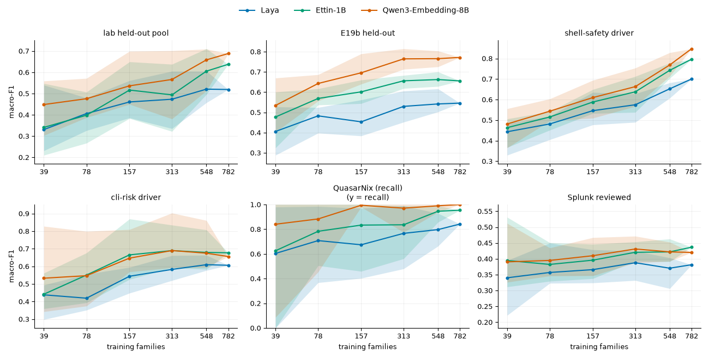

# jevmon

A process monitor for Linux workstations that run agent swarms. A decision model judges
process launches, read from an eBPF exec feed or sampled from `/proc`.

jevmon watches launches and asks a small local model to label each one safe, warn or crit. Laya is
the default judge and runs on an ordinary machine; LoRA-tuned variants of Laya and Ettin
(`laya-lora`, `ettin-lora`), Ettin-1B and Qwen3-Embedding-8B can be selected too. The code only builds a short text context from the
launch; there are no rules, scores or name lists. Every verdict is stored with its context so it can
be labelled and used for fine-tuning.

It reads exec events through a small eBPF helper that runs as root (every exec, started with
`jevmon start`), or polls `/proc` without privileges (`[exec] source = "proc"`). Nothing leaves
the machine.

<!-- screenshots:begin -->


*A pinned event with its verdict and probabilities.*

<!-- screenshots:end -->

## How it works

1. An exec source reports new process launches: the eBPF helper streams every exec, with exact
   counts of anything it lost; the `/proc` poller stays under a CPU budget of 3% of one core and
   estimates how many launches it never saw.
2. A context builder renders each launch as a short, redacted text: exe, command line, uid,
   cgroup and facts about the file, plus counts learned from the box's own history.
3. A local decision model reads the context and answers `safe`, `warn` or `crit` with a
   confidence. Five judge models are available:
   [Laya](https://huggingface.co/convaiinnovations/laya) (the default), its LoRA-tuned variant
   `laya-lora`, Ettin-1B, its LoRA-tuned variant `ettin-lora`, and Qwen3-Embedding-8B. Each is a classifier over a local or downloaded
   encoder, shipped with the app; without a head the model is zero-shot.
4. The verdict and its context are stored in SQLite. The daemon serves them on a Unix socket to
   the terminal UI and to `jevmon ctl`, where they can be labelled or acknowledged.

## Accuracy

> [!WARNING]
> These numbers rest on synthetic lab data, machine-mapped external labels and a small held-out
> set, and the labels are not independently reviewed. See the caveats in
> [lab/README.md](lab/README.md#limitations).

Laya is the default: it is the smallest judge and the one that runs on an ordinary CPU or
iGPU-only machine. `laya-lora` is the same Laya encoder with a shipped LoRA adapter merged into the
weights at load; it needs no extra dependency and runs at about Laya's speed. Ettin-1B and
Qwen3-Embedding-8B are larger backbones with more headroom on hardware that can hold them;
`ettin-lora` is Ettin-1B with a shipped LoRA adapter merged in at load. The
judge-model option is in [app/README.md](app/README.md#configuration).

Macro-F1 per set, with 95% family-cluster bootstrap CIs for the five shipped judges. QuasarNix is
crit-only, so its column is crit recall; the always-safe row gives the macro-F1 of answering
`safe` everywhere.

| judge | lab (417) | E19b held-out (828) | shell-safety (664) | cli-risk (448) | QuasarNix (196) | Splunk (300) |
| --- | --- | --- | --- | --- | --- | --- |
| Laya, default | 0.519 [0.40, 0.63] | 0.546 [0.48, 0.60] | 0.700 [0.60, 0.76] | 0.606 [0.38, 0.65] | 0.842 [0.73, 0.93] | 0.381 [0.33, 0.43] |
| Laya-LoRA | 0.582 ±0.046 | 0.850 ±0.016 | 0.946 ±0.006 | 0.700 ±0.049 | 0.740 ±0.125 | 0.474 ±0.019 |
| Ettin-1B | 0.638 [0.50, 0.74] | 0.656 [0.59, 0.71] | 0.797 [0.71, 0.86] | 0.677 [0.46, 0.71] | 0.954 [0.86, 1.00] | 0.437 [0.37, 0.50] |
| Ettin-LoRA | 0.669 ±0.020 | 0.856 ±0.004 | 0.952 ±0.001 | 0.656 ±0.034 | 0.959 ±0.000 | 0.542 ±0.015 |
| Qwen3-Embedding-8B | 0.688 [0.56, 0.79] | 0.772 [0.71, 0.82] | 0.847 [0.78, 0.89] | 0.656 [0.45, 0.69] | 1.000 [1.00, 1.00] | 0.420 [0.36, 0.47] |
| zero-shot Laya | 0.41\* | 0.440 | 0.392 | 0.406 | 0.896 | 0.395 |
| always answer safe | 0.185 | 0.241 | 0.209 | 0.280 | 0.000 | 0.199 |

The `Laya-LoRA` and `Ettin-LoRA` rows are the per-seed mean ± sd over three training seeds (each
shipped file is seed 0 alone; the ensembles they were measured with are not shipped), not a
bootstrap interval; the other
judges are deterministic and show a 95% family-cluster CI. Lab and E19b scores are higher because
their train splits are in the pool, not because LoRA fixes those command styles; the lab gain over
the frozen head is not significant for either LoRA judge, while the E19b and most external
gains are large. See the LoRA section in
[lab/README.md](lab/README.md) for the per-seed numbers and the limitations.

\* Zero-shot Laya on the lab held-out was measured on the original 130-row subset, not the full
417-row pool, and is not recomputed here.

The **lab** set is 417 held-out scenario drivers (61 script families) recorded from a rootless
podman lab. **E19b held-out** is 828 synthetic launch rows kept only where the generator, a blind
judge and a second judge agreed on the class. **shell-safety** (664) and **cli-risk** (448) are
held-out driver rows from the external sources of the same name. **QuasarNix** (196) is a crit-only
reverse-shell set. **Splunk** is a 300-row sample of real attack-replay launches whose labels were
written by the author's assistant and not reviewed.

Full tables, the per-set splits and the method are in [lab/README.md](lab/README.md). Latency, CPU
and memory are in [app/README.md](app/README.md#measured-performance).



*Each head's held-out score as the training pool grows. The mixed training pool is grouped by
family; for each fraction (5% to 100%) a stratified subset of families is drawn per seed, the fixed
recipe is fitted on those rows only and the head is scored once on the held-out sets. Lines are the
mean over 8 seeds, bands are the spread over seeds, and the 100% point is the number in the table.*

## Quick start

```sh
nix develop            # or `direnv allow`
just sync              # Python environment, CPU wheels
just exec --once       # one scan, print a summary
just daemon            # run jevmond in the foreground
just tui               # open the terminal UI
```

## Jev

The project is named for the Jev family of typed decision models: a text state and named typed
questions go in, class probabilities come out. Laya and the other judge backbones share that
interface.

## Documentation

- [app/README.md](app/README.md): the daemon, TUI and command line, install, configuration,
  judge modes, measured performance, limitations.
- [lab/README.md](lab/README.md): the lab, datasets, the shipped heads, results and limitations.

MIT licence, see [LICENSE](LICENSE).
