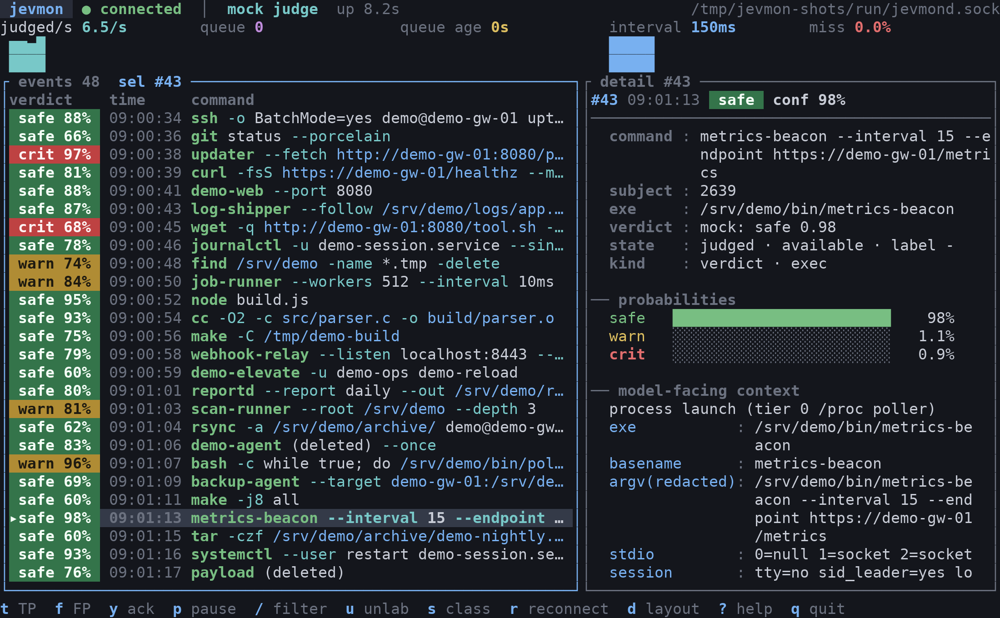
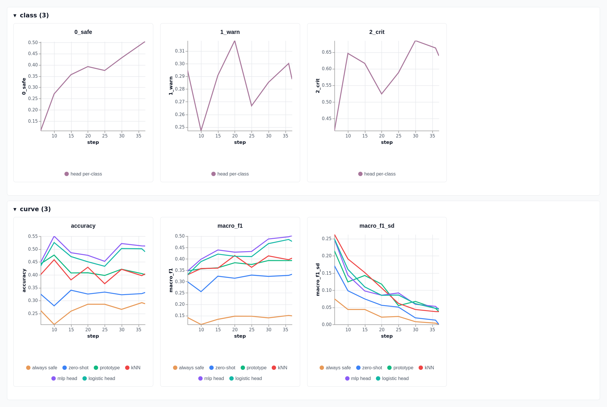

# jevmon

A process monitor for Linux workstations that run agent swarms. A decision model judges the
process launches it samples from `/proc`.

jevmon watches launches and asks a small local model (Laya) to label each one safe, warn or crit.
The code only builds a short text context from `/proc`; there are no rules, scores or name lists.
Every verdict is stored with its context so it can be labelled and used for fine-tuning.

It needs no privileges, auditd or eBPF, and nothing leaves the machine.

<!-- screenshots:begin -->



*A pinned event with its verdict and probabilities.*

<!-- screenshots:end -->

## How it works

1. A poller reads `/proc` and detects new process launches (tier 0). It stays under a CPU budget
   of 3% of one core and counts how many launches it never saw.
2. A context builder renders each launch as a short, redacted text: exe, command line, uid,
   cgroup and facts about the file, plus counts learned from the box's own history.
3. A local decision model, [Laya](https://huggingface.co/convaiinnovations/laya), reads the
   context and answers `safe`, `warn` or `crit` with a confidence. A small head trained on lab
   labels is shipped and on by default; without it the model is zero-shot.
4. The verdict and its context are stored in SQLite. The daemon serves them on a Unix socket to
   the terminal UI and to `jevmon ctl`, where they can be labelled or acknowledged.

## Accuracy

> [!WARNING]
> The current lab data has known issues: it is small and the labels were written by the author
> without independent review. It will be replaced with better data soon, and the numbers here will
> change.

Macro-F1 on held-out lab rows, measured 2026-10-12 to 2026-10-14 (420 rows, 61 families; each 95%
CI is about 0.24 wide and paired differences have CIs of about ±0.12, so none of the rows below the
head are distinguishable):

| judge | macro-F1 |
| --- | --- |
| always answer safe | not measured on this pool (0.185 on the earlier 130 rows) |
| Laya, zero-shot | 0.391 |
| Laya with the shipped head | 0.667 [0.53, 0.77] |
| Foundation-Sec-8B with a head | 0.709 [0.58, 0.81] |
| hosted Jev 1.13, zero-shot | 0.616 [0.50, 0.71] |

Scored on lab scenarios: held-out families, designed by the author. Details, caveats and the other
experiments are in [lab/README.md](lab/README.md); latency, CPU and memory are in
[app/README.md](app/README.md#measured-performance).



*Cross-validated macro-F1 and accuracy against the number of training families for each classifier, and the head's F1 per class.*

## Quick start

```sh
nix develop            # or `direnv allow`
just sync              # Python environment, CPU wheels
just exec --once       # one scan, print a summary
just daemon            # run jevmond in the foreground
just tui               # open the terminal UI
```

## Jev

The project is named for the Jev family of typed decision models: a text state and named typed
questions go in, class probabilities come out. Laya is the local one and the one jevmon runs.
TypeSafe also hosts Jev 1.13 on OpenRouter, which cannot be run locally; it was scored
zero-shot on the same held-out rows, see [lab/README.md](lab/README.md#comparison-with-typesafe-jev-113-e18).

## Documentation

- [app/README.md](app/README.md): the daemon, TUI and command line, install, configuration,
  judge modes, measured performance, limitations.
- [lab/README.md](lab/README.md): the lab, datasets, scenarios and every experiment.

MIT licence, see [LICENSE](LICENSE).
