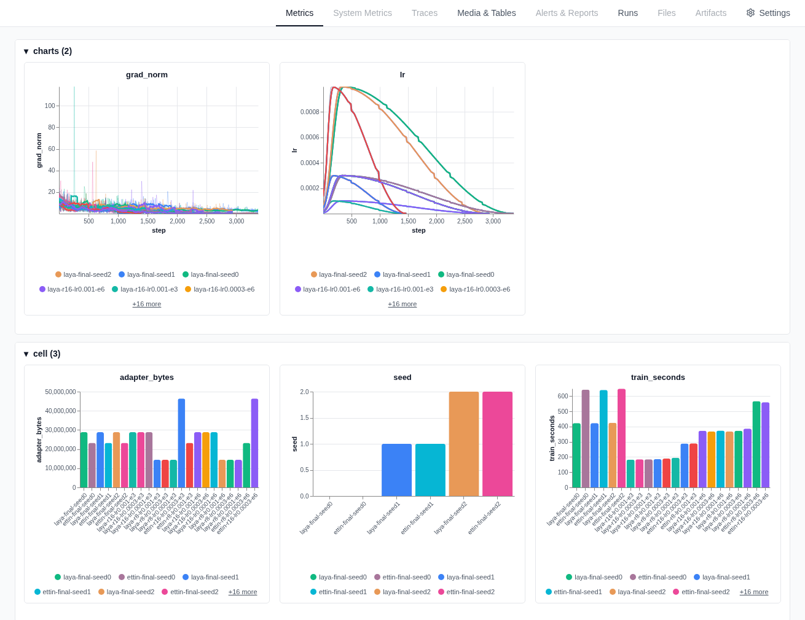

# jevmon lab

The `lab/` project builds the labelled data the jevmon judge is measured on and holds the
experiments behind the shipped heads. It runs process-launch scenarios in throwaway rootless
podman containers, records the contexts the real monitor builds for each launch, joins them to the
scenario's ground truth, and scores heads on families they never saw.

The judge itself is described in [`../app/README.md`](../app/README.md); the short overview is the
[root README](../README.md). This document describes the current data and models only.

Contents: [the lab](#the-lab) - [datasets](#datasets) - [method](#method) - [results](#results) -
[shipped heads](#shipped-heads) - [reproducing](#reproducing) - [limitations](#limitations)

## The lab

The system under test is the real pipeline: the tier-0 poller reads the host `/proc` while scenarios
run, and the context builder renders each observed launch into the text the model reads. Rootless
podman processes are visible in the host's `/proc` as ordinary pids in a nested PID namespace, so no
privileges are needed.

- Containers. A target container (systemd and an nginx payload server) runs the scenarios; an
  actor container runs a benign background worker for the whole run. Images are built from
  `lab/target/` and `lab/actor/`.
- Safety. The pod network is `--internal` (no LAN, no internet). Every container has hard
  `--memory` (no swap), `--cpus` and `--pids-limit` limits and a size-limited tmpfs. Every command
  is harmless by construction: `sleep`, `true`, `echo`, `cp` of system binaries to new names,
  short shell loops, `python -c` print or allocation loops, `curl` against the lab's own nginx.
  What differs between scenarios is the launch pattern. Teardown runs in a `finally` block, so a
  failed scenario, timeout or Ctrl-C still removes the containers and the network.
- Attribution. An observed launch is tagged with a scenario in two steps
  (`lab/src/jevmon_lab/mapping.py`): its cgroup must resolve to one of the lab's own containers
  (other containers and host processes never enter the dataset), and its time must fall inside the
  scenario's window plus a 3 second grace. Windows are validated to not overlap per container.
- Observed against expected. The manifest records how many launches each scenario spawns by
  construction. The report compares that with what the poller saw, so a missed launch is counted
  and shown per scenario instead of hidden.

Only the process a scenario deliberately launches carries its label. A scenario launches a shell
(`sh -c <step>`) that runs helpers and children (`sleep`, `cp`, nested shells, Python workers);
those descendants are still judged and can be inspected, but are not scored. The capture compares
each exec's redacted argv with the scenario's own driver argv (`mapping.designated`); an exact match
carries the label, everything else has `label = null`. Without this, identical child text such as
`sleep 3` appeared under safe and hostile families alike.

## Datasets

The current numbers rest on three kinds of data.

### Lab drivers

`lab/scenarios.toml` holds 474 scenarios in 79 families. Most were generated deterministically by
`lab/scripts/gen_scenarios.py` and `gen_scenarios2.py` (extra variants with perturbed counts,
paths and names, and extra families). A full run is about two hours, so extra variants are normally
run with `--only <ids>`.

A family is a group of parameterised variants of one launch pattern. `manifest.split_of` hashes the
family name (SHA-256 with a frozen salt) and sends about 30 percent of families to the held-out
side, so a whole family is unseen at training time; the assignments are pinned in
`lab/tests/test_lab.py`. The ground truth is one of the judge's three classes, assigned by
construction per scenario: 115 `safe`, 110 `warn` and 133 `crit` scenarios, 358 in 60 families.
The other 116 scenarios are rate or resource spikes (fork storms, retry loops, CPU spinners, memory
growth) that cannot be judged from a single launch; they stay in the manifest and the capture with
an `excluded` reason and are out of the labels and every score.

The labelled captures used today:

| capture | rows (safe / warn / crit) | families |
| --- | --- | --- |
| r6 + r7 train | 205 | 37 |
| r6 + r7 held-out | 130 (50 / 38 / 42) | 22 |
| settle recapture (held-out) | 133 (50 / 38 / 45) | 22 |
| settle fresh (held-out) | 154 (60 / 44 / 50) | 39 |
| held-out pool | 417 (160 / 120 / 137) | 61 |

A few scenarios have no labelled row because their driver lived under the poll interval; the capture
counts them. The recapture repeats earlier held-out families; the fresh capture adds newly generated
families. The held-out pool is the three held-out captures together.

Every number here is a launch seen by the poller, so short-lived processes below the poll interval
are missed (miss ratio about 0.95 in the captures). The dataset is a sample of what the poller saw.

### E19b synthetic corpus

`scripts/gen_corpus.py` (with `gen_corpus_lib.py`, `gen_corpus_validate.py`, `build_taxonomy.py`)
builds a text-only corpus of single execve-level launches from a local OpenAI-compatible LLM
server; nothing is executed, hosts are RFC 5737 / example.com, and long blobs and real-looking
secrets are rejected. `corpus_taxonomy.toml` has 496 behaviour families (crit families carry a safe
and a warn look-alike twin).

The generator prompt requires every row's class to be readable from the launch text alone (exe
path, argv shape, parent, cwd, uid, tty). `warn` is defined operationally as "an unusual launch
shape a reader can see is unusual but not hostile"; `crit` as "a hostile cue visible in the launch
itself"; `safe` as everyday workstation traffic. The same canonical class descriptions are used by
the generator, a blind second pass and a third judge, so all three read the classes the same way.

Every row is kept only under multi-judge consensus: the generating intent, a blind local `qwen3.8`
pass and a third judge (hosted Jev 1.13, or the local `qwen3.8-uncensored` when Jev cannot score a
row) must all agree. Rows that miss any judge stay in the data with `disputed = true` and are
excluded from the headline set.

The 2026-10-17 run: all 496 families, 447 calls through OpenRouter
(`deepseek/deepseek-v4.1-flash`, provider pinned to DigitalOcean), about 3.15M completion tokens
and $2.46, no empty replies and no refusals. After validation and dedupe: 3596 rows in 490
families (365 rejected). Consensus keeps 2326 of 3596 rows (64.7%): 1498 train and 828 held-out,
with 435 of 490 families keeping at least one row. `warn` is the weak class (fewer than half its
rows survive). The same family-name hash split as the lab is used, and the context is rendered
through the real `ContextBuilder`.

### External test sets

Four public sources are converted to the lab's launch schema and used as test sets: nothing is
trained or tuned on their test splits, and each is reported on its own, never pooled with another
source or with the lab pool. Converters are `scripts/ingest_*.py`, label-mapping tables are
`ingest/*.toml`, and the scorer is `scripts/ext_eval.py`. Nothing from these sources is executed;
they are command text and log lines.

One execve-level launch becomes one row (exe, argv, and cwd/uid/parent where the source has them).
A shell command line becomes a driver row (`/usr/bin/dash`, argv `sh -c <line>`) that carries the
label, plus one unlabelled child row per external program in it. A line that is a single plain
program is also scored as a direct launch. Every row is rendered by the real `ContextBuilder` with
the shipped settings, so Laya and the heads read it like a lab row. Rows are deduplicated on a
normalised launch key and rows whose key occurs in any lab, held-out or E19b row are dropped.

| source | what it is | test rows (safe / warn / crit) | families |
| --- | --- | --- | --- |
| shell-safety-v1.1 (`test` split, posix) | synthetic agent commands labelled allow / ask / deny | 664 driver (303 / 217 / 144), 422 direct | 92 |
| cli-command-risk (`test` split) | machine-generated commands labelled by worst outcome | 448 driver (325 / 39 / 84), 330 direct | 50 |
| QuasarNix | synthesized reverse-shell strings, crit only | 196 driver, 106 direct, 400 NL2Bash rows unlabelled | 10 skeletons |
| Splunk attack_data Linux | real sysmon / auditd launches from attack replays | 865 distinct launches: 808 with a folder label (187 warn / 621 crit), 57 background; 300 reviewed | 83 technique folders |

Label mapping assumptions (full tables in `ingest/`):

- shell-safety: allow is safe, ask is warn, deny is crit. Ask is an agent-permission prompt, not
  "unusual for a workstation", and some deny reasons are agent policy rather than hostile launches.
  Those rows are flagged uncertain (290 of 664 driver rows) and a "certain labels only" row (safe
  and crit, no warn) is reported.
- cli-command-risk: safe is safe; fetch-and-run and remote-code-execution categories are crit;
  privilege escalation and history tampering at high or critical are crit; credential exposure at
  high or critical is warn; low and moderate are unlabelled. Categories about self-inflicted damage
  (data destruction, device overwrite, permissions, footguns) are dropped, because the source label
  is the worst outcome if the user runs the command, not hostility.
- QuasarNix: every malicious string is crit; NL2Bash is unlabelled. The 235k strings collapse to
  10 skeletons, at most 30 variants kept per skeleton. Only recall is meaningful.
- Splunk: the technique folder gives the ATT&CK technique, its tactic gives the class (execution,
  persistence, privilege escalation, evasion, C2 and impact are crit; discovery and collection are
  warn). Launches that repeat inside a log or appear under three or more technique folders are
  background and unlabelled. The folder label is weak: the same logs hold package hooks, agent
  polling and the setup commands of each test. The 300-row reviewed sample has assistant-written
  labels (`assistant_label_unreviewed` and `ingest/splunk_provisional_labels.json`); they are
  provisional and nobody has checked them, and 15 rows are labelled from the parent process, which
  the shipped text does not show.

## Method

- Features are frozen embeddings of the rendered context, one forward pass per text, no fine-tuning.
  Laya uses the mean-pooled encoder state; Ettin-1B and Qwen3-Embedding-8B use the concatenation of
  the mean of the last layer and the mean of the 3/4-depth layer (`mean+mean75`, dimensions 1792
  and 4096). Text is capped at 512 tokens.
- A head is a plain linear classifier (L2-regularised logistic regression, balanced class weights)
  over the raw pooled embedding. The three recipes are fixed constants: weight decay 0.001 for
  Laya and Ettin-1B, 0.1 for Qwen3-Embedding-8B.
- The mixed train pool is the original lab train rows (205), the E19b consensus train rows (1498)
  and the shell-safety and cli-command-risk own train/validation rows shaped for augmentation
  (16261): 17964 rows. It mixes context layouts (the E19b rows carry the launch-time fact segments,
  the lab and external rows do not).
- The family-name hash split keeps whole families together. Held-out sets are scored once with the
  frozen choice; they are never fed back.
- Confidence intervals are a family-cluster bootstrap (10000 draws, seed 20): families are
  resampled, not rows, and each 95% CI is read as a range for the whole-family score.
- Macro-F1 is the headline metric over the classes present in a set. A single-class set (QuasarNix)
  reports recall instead.
- Always answering `safe` is given as a baseline; zero-shot Laya (no head) is given as a reference.

## Results

Macro-F1 with 95% family-cluster CIs on the held-out sets. The QuasarNix rows are crit recall.

| eval set (n, families) | Laya | Ettin-1B | Qwen3-Embedding-8B |
| --- | --- | --- | --- |
| lab held-out pool (417, 61) | 0.519 [0.40, 0.63] | 0.638 [0.50, 0.74] | 0.688 [0.56, 0.79] |
| lab old (130, 22) | 0.503 [0.32, 0.66] | 0.705 [0.51, 0.85] | 0.733 [0.54, 0.87] |
| lab recapture (133, 22) | 0.503 [0.32, 0.66] | 0.710 [0.51, 0.85] | 0.730 [0.53, 0.87] |
| lab fresh (154, 39) | 0.545 [0.41, 0.66] | 0.510 [0.37, 0.64] | 0.612 [0.46, 0.74] |
| E19b consensus held-out (828, 151) | 0.546 [0.48, 0.60] | 0.656 [0.59, 0.71] | 0.772 [0.71, 0.82] |
| shell-safety driver (664, 92) | 0.700 [0.60, 0.76] | 0.797 [0.71, 0.86] | 0.847 [0.78, 0.89] |
| shell-safety direct (422, 82) | 0.680 [0.56, 0.75] | 0.788 [0.68, 0.84] | 0.860 [0.78, 0.90] |
| shell-safety driver, certain labels only (374, 18) | 0.838 [0.68, 0.89] | 0.887 [0.79, 0.95] | 0.910 [0.82, 0.96] |
| cli-risk driver (448, 50) | 0.606 [0.38, 0.65] | 0.677 [0.46, 0.71] | 0.656 [0.45, 0.69] |
| cli-risk direct (330, 43) | 0.909 [0.54, 0.96] | 0.948 [0.61, 0.99] | 0.970 [0.71, 0.99] |
| cli-risk driver, certain labels only (405, 46) | 0.947 [0.63, 0.98] | 0.955 [0.62, 1.00] | 0.978 [0.75, 1.00] |
| QuasarNix driver, recall (196, 10) | 0.842 [0.73, 0.93] | 0.954 [0.86, 1.00] | 1.000 [1.00, 1.00] |
| QuasarNix direct, recall (106, 7) | 0.774 [0.64, 0.86] | 0.868 [0.60, 1.00] | 0.981 [0.92, 1.00] |
| Splunk reviewed (300, 83) | 0.381 [0.33, 0.43] | 0.437 [0.37, 0.50] | 0.420 [0.36, 0.47] |
| Splunk reviewed, parent-independent (285, 79) | 0.390 [0.34, 0.44] | 0.444 [0.38, 0.51] | 0.434 [0.38, 0.49] |
| Splunk folder labels, weak (808, 80) | 0.307 [0.24, 0.39] | 0.324 [0.20, 0.45] | 0.234 [0.20, 0.30] |

The two references, on the same rows:

| eval set | zero-shot Laya | always answer safe |
| --- | --- | --- |
| lab held-out pool | 0.41\* | 0.185 |
| E19b consensus held-out | 0.440 | 0.241 |
| shell-safety driver | 0.392 | 0.209 |
| shell-safety direct | 0.322 | 0.215 |
| cli-risk driver | 0.406 | 0.280 |
| cli-risk direct | 0.644 | 0.293 |
| QuasarNix driver, recall | 0.896 | 0.000 |
| QuasarNix direct, recall | 0.829 | 0.000 |
| Splunk reviewed | 0.395 | 0.199 |
| Splunk folder labels, weak | 0.364 | 0.000 |

\* Zero-shot Laya on the lab held-out pool is not recomputed here: the cached predictions cover the
original 130-row held-out subset only.

What the table shows: the mixed heads transfer across command styles. Qwen3-Embedding-8B leads
most sets; Ettin-1B is usually second and ahead of Laya almost everywhere (Laya is higher only on
the fresh lab families, within overlapping CIs); Laya is the smallest and the default. On the
external driver sets the heads sit well above the always-safe baseline, and on the weak Splunk
folder labels all three fall close to it.


The curve draws the same held-out sets as the table. The mixed train pool is grouped by family; for
each fraction (5% to 100%) a stratified subset of families is drawn per seed, the fixed recipe is
fitted on the rows of those families only, and the head is scored once on the lab pool, the E19b
held-out set and the external sets. Lines are the mean over 8 seeds and the bands are the spread
over seeds; the 100% point reproduces `lab-data-e20/results.json`.

## Shipped heads

The app ships five selectable judges (see the [judge modes](../app/README.md)). Three are a linear
head over a frozen backbone embedding (z-scoring folded into weight and bias), fitted on the
17964-row mixed train pool. The other two, `laya-lora` and `ettin-lora`, train a LoRA adapter into
the encoder and are described in the next section.

| model | backbone | feature | lab pool macro-F1 |
| --- | --- | --- | --- |
| Laya (default) | `convaiinnovations/laya` (ModernBERT-large, 421M) | mean | 0.519 |
| Laya-LoRA | `convaiinnovations/laya` + LoRA r16 | mean | 0.582 (per-seed mean) |
| Ettin-1B | `jhu-clsp/ettin-encoder-1b` | mean + 3/4-depth | 0.638 |
| Ettin-LoRA | `jhu-clsp/ettin-encoder-1b` + LoRA r8 | mean | 0.669 (per-seed mean) |
| Qwen3-Embedding-8B | `Qwen/Qwen3-Embedding-8B` | mean + 3/4-depth | 0.688 |

On the lab pool, per-class precision/recall is 0.73/0.46 (`safe`), 0.42/0.34 (`warn`) and 0.50/0.80
(`crit`) for Laya; 0.92/0.55, 0.53/0.46 and 0.60/0.95 for Ettin-1B; and 0.95/0.59, 0.55/0.58 and
0.66/0.93 for Qwen3-Embedding-8B. Each head is only usable with its own backbone's embeddings. The
three frozen heads are packaged in `app/src/jevmon/laya/heads/` and written by
`lab/scripts/train_heads.py export`; the LoRA judges are written by `lab/scripts/lora_check.py export --backbone laya|ettin`.

## LoRA judges (`laya-lora`, `ettin-lora`)

### `laya-lora`

`laya-lora` keeps the same Laya encoder but trains a small LoRA adapter into it instead of only
fitting a head on frozen features. It ships as an extra option, not the default, because it is a
better judge on the mixed pool at about the frozen encoder's cost.

- Method. PEFT LoRA on the encoder's attention and MLP projections (`Wqkv`, `Wo`, `Wi`; rank 16,
  alpha 32, dropout 0) with mean pooling and a linear 3-class head trained jointly: class-balanced
  cross-entropy with the head recipe's weights, weight decay 0.001 on the head, max 512 tokens,
  batch 16, bf16, OneCycle at lr 3e-4 for 6 epochs. At load the adapter is folded into the encoder
  weights in memory (`W += (alpha/rank)·B·A`, fp32 then cast), so serving imports no `peft` and runs
  no extra forward pass.
- Grid and selection. Rank {8, 16} × lr {1e-4, 3e-4, 1e-3} × epochs {3, 6}, one seed each, selected
  on a family-held-out dev split (about 25 % of the train families, a fifth of the pool) taken from
  the train pool only. The six eval sets were scored once, for the chosen cell (r16 / lr 3e-4 /
  6 epochs: dev macro-F1 0.795, against 0.648 for the frozen head on the same dev rows). The 12
  cells span dev 0.262 to 0.795 — a high lr or rank with too many epochs collapses.

Per-seed macro-F1 (mean ± sd over seeds 0/1/2; seed 0 is what ships, the 3-seed ensemble was
measured but is not shipped):

| eval set | Laya (frozen) | Laya-LoRA mean ± sd | seed 0 |
| --- | --- | --- | --- |
| lab held-out pool (417) | 0.519 | 0.582 ± 0.046 | 0.646 |
| E19b consensus held-out (828) | 0.546 | 0.850 ± 0.016 | 0.851 |
| shell-safety driver (664) | 0.700 | 0.946 ± 0.006 | 0.955 |
| cli-risk driver (448) | 0.606 | 0.700 ± 0.049 | 0.631 |
| QuasarNix driver, recall (196) | 0.842 | 0.740 ± 0.125 | 0.587 |
| Splunk reviewed (300) | 0.381 | 0.474 ± 0.019 | 0.499 |

- Read. LoRA is clearly ahead on E19b, shell-safety, cli-risk and Splunk. On the lab held-out pool
  the paired gain over frozen Laya is +0.044 with a 95 % family-cluster CI of [-0.09, +0.18], so it
  is not significant, and QuasarNix recall is a small-tolerance miss. The E19b and shell-safety
  train splits are in the pool, so those gains are in-distribution rather than transfer; the lab and
  QuasarNix sets were not trained on and are the honest read, and there the win is not established.
  Seed spread is wide on the small sets (QuasarNix 0.59 to 0.89).
- Cost. The 12-cell grid is about 4.6 h and the final three seeds about 1.4 h on this box's iGPU.
  The shipped adapter+head file is 27.5 MiB (seed 0 only); the merged forward measures about the
  frozen encoder's speed (`bench_lora.py`, see
  [app/README.md](../app/README.md#measured-performance)). The per-cell adapters, per-seed
  predictions and result files stay gitignored under `lab-data-lora/`; `lab/scripts/lora_check.py` reruns the grid and
  `... export` writes the packaged file from seed 0 with the per-seed numbers in its metadata.

### `ettin-lora`

The same check on Ettin-1B (`jhu-clsp/ettin-encoder-1b`), with the same pre-registered protocol, the
same train pool and the same dev split, run on a rented RTX 6000 Ada (48 GB, batch 32, bf16). The
grid was the four best Laya cells (r16/3e-4/6 epochs, r8/1e-3/3, r8/3e-4/6, r16/3e-4/3), one seed
each, and the features are the last-layer mean (the frozen Ettin head reads mean + 3/4-depth).

| cell | dev macro-F1 | train time |
| --- | --- | --- |
| r8 / lr 3e-4 / 6 epochs (chosen) | 0.803 | 567 s |
| r16 / lr 3e-4 / 6 epochs | 0.801 | 561 s |
| r16 / lr 3e-4 / 3 epochs | 0.793 | 289 s |
| r8 / lr 1e-3 / 3 epochs | 0.781 | 290 s |

The frozen Ettin head scores 0.721 on the same dev rows. Final, three seeds on the chosen cell,
scored once per eval set; the difference is the paired family-cluster bootstrap against the frozen
Ettin head (the 3-seed ensemble, 10,000 draws):

| eval set | Ettin (frozen) | Ettin-LoRA mean ± sd | seed 0 | ensemble − frozen [95% CI] |
| --- | --- | --- | --- | --- |
| lab held-out pool (417) | 0.638 | 0.669 ± 0.020 | 0.647 | +0.050 [-0.10, +0.20] |
| E19b consensus held-out (828) | 0.656 | 0.856 ± 0.004 | 0.861 | +0.209 [+0.17, +0.26] |
| shell-safety driver (664) | 0.797 | 0.952 ± 0.001 | 0.952 | +0.155 [+0.11, +0.23] |
| cli-risk driver (448) | 0.677 | 0.656 ± 0.034 | 0.624 | -0.048 [-0.08, +0.06] |
| QuasarNix driver, recall (196) | 0.954 | 0.959 ± 0.000 | 0.959 | +0.005 [-0.03, +0.05] |
| Splunk reviewed (300) | 0.437 | 0.542 ± 0.015 | 0.540 | +0.124 [+0.07, +0.18] |

- Read. Three sets improve with intervals that exclude 0 (E19b, shell-safety, Splunk); none is lost.
  The lab gain is not significant, as with Laya. The E19b and shell-safety train splits are in the
  pool, so those two gains are in-distribution. Splunk was not trained on, but its labels are
  unreviewed. Seeds agree closely here (sd at most 0.034), unlike the Laya adapter.
- Ship rule. It was set before the run: ship if no eval set is lost with a significant interval, at
  least three gain significantly, and the adapter is about 100 MiB or less. All three hold, so
  `ettin-lora` is selectable. As with Laya it is seed 0 alone, merged into the encoder at load
  (22.1 MiB adapter + head).
- Cost. The selection took 28 min and the three final seeds 32 min on the pod; the whole session,
  including the Laya rerun below, was about 2.5 h at $0.74/h.

### Laya rerun

The same Laya grid and three final seeds were rerun on the pod with the tracked code, from scratch,
to see how repeatable the check is. The shipped `laya-lora` file is the adapter from the first run;
the rerun was not used to replace it.

| | first run (shipped) | rerun |
| --- | --- | --- |
| chosen cell | r16 / 3e-4 / 6 epochs | r16 / 1e-3 / 6 epochs |
| chosen cell dev macro-F1 | 0.795 | 0.790 |
| same cell (r16 / 3e-4 / 6) dev macro-F1 | 0.795 | 0.768 |
| lab / E19b / shell-safety (per-seed mean) | 0.582 / 0.850 / 0.946 | 0.453 / 0.537 / 0.804 |
| cli-risk / QuasarNix / Splunk (per-seed mean) | 0.700 / 0.740 / 0.474 | 0.790 / 0.577 / 0.423 |

Selection picked a different cell because several cells sit within 0.03 dev macro-F1 of each other
with a single seed each, and the rerun's winner (lr 1e-3) is unstable across seeds (E19b macro-F1
0.20, 0.58 and 0.83 for seeds 0 to 2). So the Laya grid is noisy and its selection is not reliable
beyond "r16 at lr 3e-4 to 1e-3, 6 epochs". Ettin's seeds were stable at the lower lr. Per-seed
numbers and the dev grid are in `lab-data-lora-rerun/summary.md`.

## Reproducing

Everything runs from the repository root inside the dev shell (`nix develop`). The captured data
(`data/archive/lab-data-*`, `data/external/*`), the cached embeddings and the models are
gitignored (`data/`, `lab-data*/`, `lab/cache/`, `models/`).

Lab capture and the mixed-style heads (needs the lab, E19b and external dirs and the backbone
caches; the first command is resumable and runs on the iGPU):

```sh
just sync-lab
just lab-build          # jevlab-target and jevlab-actor images
just lab-smoke          # 3 scenarios, a few minutes

python lab/scripts/gen_scenarios.py   # regenerate scenario families and variants
uv run --project lab jevmon-lab run --judge none --out lab-data

python lab/scripts/gen_corpus.py      # E19b synthetic corpus
python lab/scripts/ingest_shell_safety.py   # also: ingest_cli_risk.py, ingest_quasarnix.py, ingest_splunk.py

just gpu-run-lab python lab/scripts/train_heads.py embed-laya   # Laya mean embeddings (iGPU)
just run-lab     python lab/scripts/train_heads.py run          # fit + score, writes lab-data-e20
```

The LoRA judge (needs the optional `lora` extra for `peft` to train; grid + final on the iGPU):

```sh
uv sync --project lab --group gpu --no-group cpu --extra lora
just gpu-run-lab python lab/scripts/lora_check.py all      # grid, 3 seeds, report (iGPU, hours)
just run-lab     python lab/scripts/lora_check.py export   # package lab-data-lora/final seed 0
just gpu-run-lab python lab/scripts/bench_lora.py --device gpu --batches 1,32
```

The learning-curve figure (CPU, a few minutes; installs the optional `plots` extra):

```sh
uv run --project lab --extra plots python lab/scripts/learning_curve.py
```

External scoring and the judge benchmark:

```sh
just gpu-run-lab python lab/scripts/ext_eval.py \
    --data lab-data-ext-shell-safety lab-data-ext-cli-risk lab-data-ext-quasarnix \
           lab-data-ext-splunk --out lab-data-ext-results
just gpu-run-lab python lab/scripts/bench_judge.py --device gpu --dtype bf16,fp16,fp32 --batches 1,8,32
```

`train_heads.py run` writes `lab-data-e20/results.json` and `summary.md`, which are the source of
every number on this page. The judge is described in [`../app/README.md`](../app/README.md).

### Tracking runs (Trackio)

`lab/scripts/lora_check.py` logs every run through `jevmon_lab.runlog` to a Trackio project
`jevmon-lora` (one run per selection cell `{backbone}-{cell}` and final seed
`{backbone}-final-seed{N}`, plus a frozen-head reference run and a seed summary) when the optional
`trackio` extra is installed. Without it the run still writes a JSONL mirror at `<out>/metrics.jsonl`.
The store is the local SQLite DB under `TRACKIO_DIR` (default `runs/`); nothing is synced anywhere.
View it locally (dashboard on `127.0.0.1:7861`, or just list the runs):

```sh
uv sync --project lab --extra trackio   # once; or run with --extra trackio
just runs                                # dashboard on http://127.0.0.1:7861
just runs-list                           # projects + runs of jevmon-lora, no dashboard
```

A pod run (`lab/scripts/pod_run_lora.sh`) writes its store to `/workspace/trackio-runs`; rsync that
back and open it with `TRACKIO_DIR=$PWD/trackio-runs just runs`. `--no-track` disables Trackio and
leaves the JSONL mirror as the only log.

```sh
# bring a pod run's store and results back into the worktree
rsync -av root@<pod>:/workspace/trackio-runs/ ./trackio-runs/
rsync -av root@<pod>:/workspace/jevmon/lab-data-lora-ettin/ ./lab-data-lora-ettin/
rsync -av root@<pod>:/workspace/jevmon/lab-data-lora-rerun/ ./lab-data-lora-rerun/
TRACKIO_DIR=$PWD/trackio-runs just runs   # or: just runs-list
```



The dashboard for the runs on this page (Laya and Ettin selection cells, final seeds and the Laya
rerun): per-step gradient norm and learning rate, and per-cell adapter size, seed and train time;
per-epoch dev metrics sit further down the page.

To capture a dashboard page headlessly for README images, the dev shell has no Playwright; Chromium
from nixpkgs works against the running dashboard:

```sh
just runs &   # dashboard on 127.0.0.1:7861
nix shell nixpkgs#chromium -c chromium --headless --disable-gpu --no-sandbox \
    --window-size=1600,1000 --screenshot=docs/screenshots/trackio-lora.png \
    http://127.0.0.1:7861
```

## Limitations

- Small held-out. The lab pool is 417 rows in 61 families, and the E19b held-out is 828 rows but
  built from LLM-generated families; the CIs are wide and overlapping, so small differences between
  heads are not resolved. Laya's lab score is below the 8B and Ettin heads.
- In-distribution external rows. The heads were trained on the shell-safety and cli-command-risk
  own train splits, so the driver and direct scores on those two sets are in-distribution, not
  transfer. QuasarNix (crit-only, so crit recall) and Splunk were not trained on.
- Weak labels. The Splunk labels were written by the author's assistant and are not independently
  reviewed; the shell-safety and cli-command-risk labels come from a mapping of those datasets'
  categories, with some rows flagged uncertain and dropped from the "certain labels only" rows.
  The E19b rows are LLM-generated synthetic launches, kept only where the generator, a blind judge
  and a second judge agreed; their labels are not human-checked.
- Synthetic, one box. Every lab scenario is a scripted, harmless command in a container, and the
  held-out families were designed by the same author. Families unlike the manifests are untested,
  and nothing here says how the judge behaves on a real workstation.
- Mixed layouts. The mixed train pool mixes context formats, so every mixed-pool number carries
  that confound.
- Selection bias. The held-out sets were inspected by hand over the course of the work, so the
  best of several measurements is biased upward.
- LoRA judges. `laya-lora` and `ettin-lora` are each a single adapter (seed 0), not the 3-seed
  ensemble that was measured; the E19b and shell-safety train splits are in their train pool, so
  their gains there are in-distribution rather than transfer, and the lab-pool gain over the
  frozen head is not significant for either. The selection grids use one seed per cell and are
  noisy (the Laya rerun chose a different cell). They need `peft` to retrain but not to serve.
- Latency. Laya runs a context in 42-44 ms on the iGPU. An 8B encoder of the class of
  Qwen3-Embedding-8B was measured at 95-179 ms per context and 16.1 GiB of GPU memory; Ettin-1B and
  `ettin-lora` were not measured on the iGPU.
- Missed launches. The tier-0 poller misses most processes shorter than its interval, so the
  dataset is a sample of what the poller saw, not of every launch.
