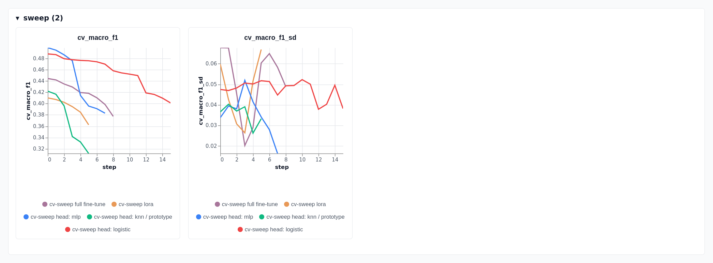
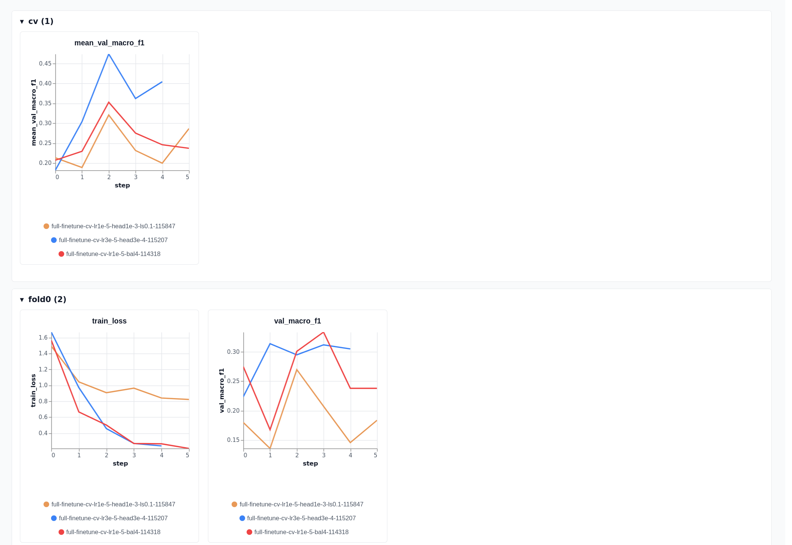

# jevmon lab

> [!WARNING]
> The current lab data has known issues: it is small and the labels were written by the author
> without independent review. It will be replaced with better data soon, and the numbers here will
> change.

The `lab/` project builds the labelled data jevmon is judged on and holds every experiment run on
it. It runs process-launch scenarios in throwaway rootless podman containers, records the contexts
the real monitor builds for each launch, joins them to the scenario's ground truth, and then
scores judges (zero-shot prompts, heads on frozen embeddings, LoRA, full fine-tuning, other
backbones) on families the judges never saw.

The monitor itself is described in [`../app/README.md`](../app/README.md). The root
[README](../README.md) has the short overview.

Contents: [the lab](#the-lab) -
[scenarios and labels](#scenarios-families-splits-and-labels) -
[data pipeline and scripts](#data-pipeline-and-scripts) -
[how to read the numbers](#how-to-read-the-numbers) -
[results at a glance](#results-at-a-glance) -
[experiments](#experiments) - [caveats](#caveats) - [reproducing](#reproducing)

## The lab

The system under test is the real pipeline: the tier-0 poller reads the host `/proc` while
scenarios run, and the context builder renders each observed launch into the text the model reads.
Rootless podman processes are visible in the host's `/proc` as ordinary pids in a nested PID
namespace, so no privileges are needed.

- Containers. A target container (systemd and an nginx payload server) runs the scenarios; an
  actor container runs a benign background worker for the whole run. Images are built from
  `lab/target/` and `lab/actor/`.
- Safety. The pod network is `--internal` (no LAN, no internet). Every container has hard
  `--memory` (no swap), `--cpus` and `--pids-limit` limits and a size-limited tmpfs. Every command
  is harmless by construction: `sleep`, `true`, `echo`, `cp` of system binaries to new names,
  short shell loops, `python -c` print or allocation loops, `curl` against the lab's own nginx.
  What differs between scenarios is the launch pattern. Teardown runs in a `finally` block, so a
  failed scenario, timeout or Ctrl-C still removes the containers and the network.
- Attribution. An observed launch is tagged with a scenario in two steps
  (`lab/src/jevmon_lab/mapping.py`): its cgroup must resolve to one of the lab's own containers
  (other containers and host processes never enter the dataset), and its time must fall inside the
  scenario's window plus a 3 second grace. Windows are validated to not overlap per container.
- Observed against expected. The manifest records how many launches each scenario spawns by
  construction. The report compares that with what the poller saw, so a missed launch is counted
  and shown per scenario instead of hidden.

## Scenarios, families, splits and labels

`lab/scenarios.toml` holds 474 scenarios in 79 families. Most were generated, deterministically
and once, by `lab/scripts/gen_scenarios.py` and `lab/scripts/gen_scenarios2.py` (extra variants
with perturbed counts, paths and names, and extra families). A full run is about two hours, so
extra variants are normally run with `--only <ids>`.

Families and splits. A family is a group of parameterised variants of one launch pattern.
`manifest.split_of` hashes the family name (SHA-256 with a frozen salt) and sends about 30 percent
of families to the held-out side. A whole family is therefore unseen at training time. Family
names are descriptive and are never chosen to steer which side they land on; the assignments are
pinned in `lab/tests/test_lab.py`.

Classes. The ground truth is one of the judge's three classes, assigned by construction per
scenario:

| class | families (examples) |
| --- | --- |
| `safe` | `build_fanout`, `pkg_install`, `interactive_shell`, `cron_timer`, `ssh_session`, `agent_swarm`, `log_rotate`, `source_checkout`, `test_runner` |
| `warn` | `home_script`, `new_tool`, `debugger_launch`, `admin_scan`, `local_server`, `tool_upgrade` |
| `crit` | `tmpfs_copy`, `inline_encoded`, `unexpected_parent`, `hidden_cron`, `curl_pipe`, `reverse_shell`, `setuid_copy`, `base64_pipe` |

Rate and resource scenarios are excluded. Fork storms, retry loops, CPU spinners and memory
growth (116 scenarios) cannot be judged from one launch: each launch in a storm looks like any
other. They stay in the manifest and in the capture with an `excluded` reason, and are left out of
the labelled export and of every score. They were never relabelled. After exclusion, 358 of 474
scenarios in 60 of 79 families carry a label.

Only the driver process is labelled. A scenario launches a shell (`sh -c <step>`) that runs
helpers and children (`sleep`, `cp`, nested shells, Python workers). Only the process the scenario
itself launches carries the scenario label. The capture compares each exec's redacted argv with
the scenario's own driver argv (`mapping.designated`); an exact match is `designated: true` and
carries the label. Every other exec in the window has `label = null`, with the scenario label
kept for audit. Descendants are still judged and can be inspected, but are not scored.

The reason is in [E4 and E5](#e4-e5-designated-process-labels): before this change identical
child text such as `sleep 3` appeared under safe and hostile families alike, so no judge could be
right on all of it.

Resulting data (r6 and r7, three classes).

| split | launches | families |
| --- | --- | --- |
| train | 205 | 37 |
| held-out | 130 (safe 50, warn 38, crit 42; 124 unique contexts) | 22 |

Some scenarios have no labelled row because their driver lived under the poll interval; the
capture counts them. A few perturbed scenarios errored and give no row either (21 in the r7 run).

## Data pipeline and scripts

```
scenarios.toml --jevmon-lab run--> contexts.jsonl, scenarios.jsonl, dataset.jsonl, report.md
                                          |
                relabel_three_class.py    v
                                   labelled dataset (safe / warn / crit, runaway excluded)
                                          |
        cached frozen embeddings  -->  heads, LoRA, full fine-tune, other backbones
                                          |
                           family-grouped CV on train  ->  held-out scored once
```

Output of a run (default `lab-data/`, gitignored): `contexts.jsonl` (every recorded context and
its scenario tag, with all computed facts and argv), `scenarios.jsonl` (ground truth and observed
or missed counts), `dataset.jsonl` (rows: context, signature, label, family, split, verdict),
`report.md` and `meta.json`. Judge modes for `run`: `none` records contexts only, `fake` is a
deterministic stand-in used by tests, `laya` runs the real model.

| script | purpose |
| --- | --- |
| `src/jevmon_lab/` | manifest, pod lifecycle, capture, mapping, runner, dataset, metrics, `jevmon-lab` CLI |
| `scripts/gen_scenarios.py`, `gen_scenarios2.py` | generate scenario families and variants |
| `scripts/relabel_three_class.py` | map a four-class capture to safe / warn / crit, excluding runaway |
| `scripts/sweep_zero_shot.py` | zero-shot sweep over question wording, class descriptions and context format |
| `scripts/finetune_head.py` | head on frozen Laya embeddings, selected by train-CV |
| `scripts/finetune_laya.py`, `lab_tune.py` | full fine-tune of the checkpoint; train-CV selection harness |
| `scripts/improve_lib.py`, `improve_sweep.py` | shared harness and train-CV sweep over heads, LoRA and full fine-tune |
| `scripts/improve_final.py`, `improve_final_ft.py` | held-out scoring of fixed candidates |
| `scripts/train_head_v3.py` | fit the shipped-recipe head and verify it through the real `LayaDecider` |
| `scripts/learning_curves.py` | curves over the number of training families |
| `scripts/sweep_summary.py` | re-plot the sweep ranked per method |
| `scripts/backbone_embed.py`, `backbone_eval.py`, `backbone_lora.py`, `backbone_confirm.py` | other backbones (frozen features, decoder LoRA, confirmation) |
| `scripts/bench_judge.py` | judge latency by device, dtype, batch size, threads |
| `scripts/jev_probe.py`, `jev_score.py`, `jev_heads.py` | hosted Jev 1.13 on the lab rows: request builder and cached client, scoring and bootstrap, local head predictions (E18) |

Experiments are tracked with [Trackio](https://github.com/gradio-app/trackio), locally only
(`just runs` serves the dashboard on `127.0.0.1:7861`).



*Every head, LoRA and full fine-tune configuration tried on the three classes, ranked per method
by cross-validated macro-F1 (left) with the spread between folds (right).*

## How to read the numbers

- Selection and scoring are separate. Every choice (prompt wording, context format, pooling,
  weight decay, epochs, learning rate) is made by cross-validation grouped by family, inside the
  train families. Held-out families are scored once per final candidate and never fed back.
- Baselines sit next to every number. Always answering the first class (always-safe, earlier
  always-routine) and the majority-class rate are given with each table. Accuracy alone mostly
  shows the class mix.
- Macro-F1 is the headline metric, with per-class precision and recall (P/R) where it
  matters.
- Rows and unique contexts. "Rows" counts every labelled launch, repeats included. "Unique"
  counts distinct (context text, label) pairs. After the designated-process labelling they are
  nearly equal.
- Resolution. With 130 held-out launches, differences below about 0.07 macro-F1 are not
  resolved. Resampling the training rows moves the head's macro-F1 by about 0.04.

## Results at a glance

Zero-shot, Laya is barely better than always answering safe. The lab (`lab/`, rootless podman)
runs 474 scenarios from 79 families in throwaway containers and records the context the monitor
builds for each launch. 358 scenarios from 60 families have a single-launch label; the rest are
fork storms, retry loops and similar rate or resource scenarios, which cannot be judged from one
launch and are left out of the labels and the scores. Only the process a scenario deliberately
launches carries its label; helpers and children are left unlabelled. Families are split into
train and held-out. Model choices are made by cross-validation grouped by family inside the train
set (37 families, 205 launches), and the held-out families (22 families, 130 launches) are scored
once (E12).

| judge | accuracy | macro-F1 |
| --- | --- | --- |
| always answer safe | 0.385 | 0.185 |
| zero-shot Laya | 0.408 | 0.411 |
| head on frozen embeddings | 0.723 | 0.718 |
| LoRA fine-tune (3 seeds) | 0.638 ± 0.093 | 0.623 ± 0.075 |
| full fine-tune (3 seeds) | 0.621 ± 0.024 | 0.618 ± 0.030 |

The head is a small classifier over the frozen encoder, and it is what `[judge] tuned` loads.
Per class, the head's precision/recall on held-out is 0.79/0.76 for safe, 0.71/0.63 for warn and
0.67/0.76 for crit: about one crit verdict in three is not crit. Fine-tuning the encoder did not
beat the head, and LoRA varies a lot between seeds. Resampling the training rows moves the head's
macro-F1 by about 0.04, and 130 held-out launches cannot separate differences below roughly 0.07.
Cross-validated on the training families the same head scores about 0.47, so the held-out
families are the easier ones: on 39 families designed afterwards the same head scores 0.59. A
bigger backbone (Foundation-Sec-8B) was +0.049 on the new rows with a CI that includes 0, so the
head stays on Laya. The lab is synthetic, so these numbers say little about a real
workstation.

Tried without a clear gain: bigger backbones (Foundation-Sec-8B, Qwen3-Embedding-8B, Ettin-1B;
at best +0.049 to +0.072 macro-F1, every CI includes 0, E13), LoRA and full fine-tune (both lose
to the frozen head), raw against redacted argv and the template segment (E15), launch-time facts
and the environment (E16, E17; the extra text hurts a frozen head), hosted Jev 1.13 (same range
as the local heads, E18), and 3655 synthetic LLM-generated rows (E19; 54% label agreement with
the generating intent, no gain). Planned or under way, not results: external labelled datasets
(shell-safety, Splunk attack_data, CasinoLimit) as separate never-trained-on test sets and as
extra training data; a tighter generator brief with launch-visible cues only and multi-judge
consensus; a pre-registered rerun of the Foundation-Sec plus sorted-environment lead from E16;
and human review of a sample of the synthetic labels.



*Training loss and validation macro-F1 per fold for three full fine-tune configurations on the earlier four-class, smaller data set (not rerun on three classes).*


*Cross-validated macro-F1 and accuracy against the number of training families for each classifier, and the head's F1 per class.*

## Shipped heads

`lab/heads/` holds the frozen-backbone heads of E13 to E15, fitted with the E15 variant A recipe on
the 206 train rows (37 families) from cached embeddings, as plain linear heads (z-scoring folded
into weight and bias). Each file records backbone, layer, recipe, text format, date and its pool
macro-F1 on the 420 held-out rows (61 families) in its metadata. Written by `scripts/ship_heads.py`.

| file | backbone | size | pool macro-F1 |
| --- | --- | --- | --- |
| `foundation-sec-8b.safetensors` | `fdtn-ai/Foundation-Sec-8B`, mean of the 3/4-depth layer, dim 4096 | 49 KB | 0.709 |
| `qwen3e-8b.safetensors` | `Qwen/Qwen3-Embedding-8B`, mean of the 3/4-depth layer, dim 4096 | 49 KB | 0.692 |
| `ettin-1b.safetensors` | `jhu-clsp/ettin-encoder-1b`, mean of the 3/4-depth layer, dim 1792 | 22 KB | 0.703 |

Each head is only usable with its own backbone's embeddings; the app loads Laya only (its head is
`app/src/jevmon/laya/heads/lab-head-v4.safetensors`). The fine-tuned encoder checkpoints (LoRA and
full, about 800 MB each) are not in the repo.

## Experiments

Numbers are in the order the work happened. The four-class results (routine, unusual, suspicious,
runaway) are history: they used a class set that one launch cannot support, and the data they were
measured on has since been relabelled and reduced. They are kept as a record of dead ends. The current results are [E12](#e12-three-classes-one-axis),
[E13](#e13-backbones-for-the-three-class-judge) and [E14](#second-held-out-capture-e14).

### Stage 0: zero-shot on the first lab (four classes, superseded)

First full run: 35 scenarios in 18 families, `--judge laya`, checkpoint `english` on the iGPU.
563 contexts, 524 labelled.

The zero-shot judge answered `routine` for every one of the 563 contexts, with diffuse confidence
(median routine probability 0.61, range 0.41 to 0.75). Accuracy 0.781 and macro-F1 0.219 are what
always answering `routine` scores. Recall for unusual, suspicious and runaway was 0 of 17, 0 of 26
and 0 of 72. A hand-written `sh -c 'curl ... | sh'` context did get `suspicious` (0.48), so the
model is not hardwired; the lab's context format and the zero-shot calibration flatten it. The
poller missed a lot: a host-global miss ratio of 0.98, and 33 percent of runaway launches
observed.

### Zero-shot description sweep (four classes, superseded)

Question: can wording alone make the zero-shot model useful? The sweep varied the question
wording, the class descriptions and the context format (`lab/scripts/sweep_zero_shot.py`,
`lab/scripts/lab_tune.py zero`). The stage-3 selection scored 48 configurations (4 question
wordings, 3 class description sets, 4 context formats) by 5-fold family-grouped CV on the 34
families of that dataset (84 scenarios, three merged runs, 1424 labelled rows).

| zero-shot candidate | train-CV macro-F1 | held-out macro-F1 | held-out accuracy |
| --- | --- | --- | --- |
| always-routine | 0.14 | 0.208 | 0.711 |
| CV pick (`q_which`, rich descriptions, command lines) | 0.171 | 0.306 | 0.723 |
| earlier pick made on held-out (optimistic) | 0.167 | 0.371 | 0.764 |

Held-out is 870 rows (71 percent routine; 490 rows are one repeated `sleep infinity` line). The
better-looking pick was chosen on held-out and is optimistic. The gain over the baseline is
`runaway` recall; `suspicious` was never predicted (0 of 51). Earlier stage-1 and 2 numbers
on 524 rows (zero-shot 0.532, head 0.371, fine-tune 0.344) rested on four positives per class and,
for zero-shot, a pick made on held-out; they are discarded.

### Head on frozen embeddings (four classes, superseded)

A linear layer over the mean-pooled last hidden state of the frozen encoder, class-balanced
logistic regression, selected by family-grouped CV.

| judge (34 families, 870 held-out rows) | accuracy | macro-F1 | unique-context macro-F1 |
| --- | --- | --- | --- |
| always-routine | 0.711 | 0.208 | 0.082 |
| zero-shot (earlier pick) | 0.764 | 0.371 | 0.296 |
| head on frozen embeddings | 0.854 | 0.681 | 0.552 |
| full fine-tune (best of 3 on CV) | 0.824 | 0.563 | - |

On unique contexts (n = 76) the head's accuracy is 0.566. The win was uneven: `idle_daemon` (490
of 870 held-out rows) was easy, while `new_tool` was 0 of 18 (called suspicious), `port_scan` 3 of
12, `reverse_shell` 3 of 15 and `home_script` 12 of 36. Routine precision on unique contexts was
0.54 with recall 0.47.

### Full fine-tune of the checkpoint (four classes, superseded)

`lab/scripts/finetune_laya.py` and `lab_tune.py ft-cv`, 3 grouped folds, per-epoch validation.
Three configurations were tried and then stopped, as agreed beforehand.

| configuration | train-CV macro-F1 (epoch 3) |
| --- | --- |
| encoder lr 1e-5, head lr 1e-4, balance 4 | 0.353 |
| encoder lr 3e-5, head lr 3e-4, balance 4 | 0.474 |
| encoder lr 1e-5, head lr 1e-3, label smoothing 0.1 | 0.321 |
| head over frozen embeddings, same 3 folds | 0.499 |

The best configuration scored 0.563 on held-out against the head's 0.681, one seed each. Its CV
curve peaks at epoch 3 and then falls. With about 110 unique training contexts the fine-tune is
noisier than a regularised linear head. Variance was not measured: one seed per configuration.

### E1 context: parent command and sibling rate (four classes, negative)

Hypothesis: the model is blind to who spawned a launch, so adding the parent's command line and a
per-parent exec rate separates routine fan-out from runaways. The context builder gained a
`parent_cmd` segment and a `siblings` fact, both gated through `[context] order` and off by
default. Scored by train-CV unique macro-F1 with the frozen head, still under the old
inherit-the-label scheme (always-routine about 0.08):

| format | train-CV macro-F1 |
| --- | --- |
| shipped (command only) | 0.455 to 0.485 |
| plus `parent_cmd` | 0.37 to 0.39 |
| plus ancestors | 0.35 |
| plus structural facts | 0.37 |
| plus seen counts and surprisal | 0.33 to 0.35 |
| every segment | 0.39 |

Every added segment hurt. The conclusion held on a second set (merged 64-family data): best
fold-mean 0.454 for the shipped format against 0.372 and 0.369 for parent and structural formats.
The next entries suggest this says more about the lab than about the idea.

### E2 layers, pooling, classifier family, checkpoints (four classes, negative)

All 29 hidden layers cached (mean and CLS pooling), several classifiers and three Laya
checkpoints, train-CV unique macro-F1:

| variant | train-CV macro-F1 |
| --- | --- |
| logistic regression (last layer, mean) | 0.467 to 0.494 |
| MLP, 256 hidden units | 0.43 to 0.46 |
| MLP, 64 hidden units | 0.38 to 0.44 |
| kNN, k = 5 | 0.358 |
| nearest prototype | 0.345 |
| layers 4 to 28, mean pooling | 0.39 to 0.47 (layer 27 best at 0.467) |
| CLS pooling, any layer | 0.33 to 0.40 |

Held-out for the three checkpoints on the original set (one look each, not used for selection),
rows and unique macro-F1: `english` 0.681 / 0.552, `multilingual` 0.689 / 0.566,
`typed-decisions` 0.691 / 0.571. The differences are inside noise. The linear head on the last
layer's mean stayed.

### E3 more families: label noise shows up (four classes)

Twenty-nine new families (58 scenarios, 174 scenarios in 64 families in total) were added to lift
held-out performance. The held-out rows then collapsed: always-routine scored accuracy 0.346 and
macro-F1 0.128; the head scored 0.207 and 0.242 on 1,406 rows, but 0.493 and 0.481 on 142 unique
contexts. 756 of 1,406 held-out rows were `runaway`, most of them `sleep N` children of
fork and respawn drivers, textually identical to routine children. No judge can separate
identical text with different labels. The labels were at fault, not the model: weighting
rows by unique context changed nothing (0.246 against 0.242).

The learning curve on these data (unique macro-F1, train-CV): 7 families 0.25, 14 0.36, 22 0.39, 29
0.47, still rising.

### E4, E5 designated-process labels

The fix is described under [scenarios and labels](#scenarios-families-splits-and-labels): label
only the process a scenario itself launches. It is an equality check against what the lab itself
launched, not a rule about names or paths, and it does not select evaluation data by label
(dropping rows whose text has two labels would).

Result on a full rerun of the 64-family manifest (171 labelled rows, 168 unique texts, 0 texts
with two labels; held-out 71 rows, always-routine accuracy 0.254 and macro-F1 0.101):

| candidate | accuracy | macro-F1 | bootstrap macro-F1 |
| --- | --- | --- | --- |
| zero-shot (shipped config) | 0.338 | 0.269 | - |
| head, shipped recipe retrained | 0.465 | 0.445 | 0.43 +- 0.04 |
| same, z-scored | 0.437 | 0.419 | 0.37 +- 0.02 |
| CV winner: `parent_cmd` format, z-scored, wd 0.1 | 0.380 | 0.373 | 0.29 +- 0.06 |
| stored earlier head (old data) | 0.507 | 0.479 | - |

The duplicate-child collapse is gone and rows equal unique contexts. The `parent_cmd` format won
cross-validation (0.40) and lost on held-out. That was an artefact: in the lab every driver's
parent is the same `conmon` command line (4 distinct strings in 171 rows, across all labels), so
the segment is a constant that only shifts the embedding. Parent and sibling context stays gated
and off. No retrained candidate beat the stored head within noise (n = 71, F1 sd about 0.06).
Routine recall was the weak spot (0.17 to 0.22).

### E6 more variants (four classes)

Four new variants per existing family plus 15 new families brought the manifest to 474 scenarios
in 79 families (21 scenarios errored and give no row). Labelled data r6 plus r7: 447 rows, all
unique; train 273 rows from 49 families, held-out 174 rows from 30 families. Head family,
train-CV macro-F1 (always-routine about 0.10):

| classifier | train-CV macro-F1 |
| --- | --- |
| logistic, mean pooling | 0.39 to 0.41 (weight decay 0.003 to 0.1 flat) |
| logistic, mean plus CLS | 0.33 to 0.39 |
| MLP, 128 or 512 hidden units | 0.37 to 0.38 |
| kNN | 0.30 to 0.33 |
| prototypes | 0.31 |

Compared with 0.32 to 0.35 on r6 alone, 2.7 times the rows bought about 0.06. The head family
was saturated near 0.40 to 0.42.

### E7, E8, E8b encoder training against heads (four classes, ties or loses)

LoRA (rank 8 on every attention and MLP projection) and full fine-tune on the same folds, own
training loop without peft: mean-pooled encoder, dropout, linear, class-balanced cross-entropy,
AdamW, one-cycle, bf16, batch 16, 2 seeds per cell. Train-CV macro-F1 (mean +- sd over 8 fits):

| configuration | macro-F1 |
| --- | --- |
| head, logistic (wd 0.01 to 0.1) | 0.41 +- 0.04 |
| LoRA, 6 epochs, lr 1e-4 / 3e-4 / 1e-3 | 0.393 / 0.462 / 0.429 |
| LoRA, 10 epochs, lr 1e-4 / 3e-4 / 1e-3 | 0.396 / 0.365 / 0.487 |
| full, 6 epochs, lr 1e-5 / 2e-5 / 4e-5 | 0.352 / 0.411 / 0.391 |
| full, 10 epochs, lr 1e-5 / 2e-5 / 4e-5 | 0.343 / 0.351 / 0.434 |
| full, 14 epochs, lr 1e-5 / 2e-5 / 4e-5 | 0.358 / 0.412 / 0.425 |

The first held-out scoring (E8) used LoRA at 6 epochs, lr 3e-4, because the table in the log
omitted the 10 epoch, lr 1e-3 cell by mistake. E8b scored that cell too, so held-out was looked at
for two LoRA cells, the second being the CV winner. Held-out, 174 rows, always-routine accuracy
0.287 and macro-F1 0.112:

| candidate | accuracy | macro-F1 |
| --- | --- | --- |
| zero-shot | 0.362 | 0.276 |
| stored earlier head (old data) | 0.471 | 0.459 |
| head, shipped recipe retrained on clean labels | 0.517 | 0.525 |
| head, CV-best (z-scored, wd 0.1) | 0.460 | 0.465 |
| LoRA, 6 epochs, lr 3e-4 (3 seeds) | 0.464 +- 0.031 | 0.457 +- 0.035 |
| LoRA, 10 epochs, lr 1e-3 (3 seeds, E8b) | 0.542 +- 0.078 | 0.538 +- 0.071 |
| full, 10 epochs, lr 4e-5 (3 seeds) | 0.431 +- 0.023 | 0.432 +- 0.023 |

The retrained recipe head's bootstrap over 20 resamples of the train rows was 0.531 +- 0.039. The
CV edge of encoder training was selection noise: the first LoRA cell scored (0.462) sat
next to a neighbouring cell at 0.365, and the CV-best LoRA ties the head on held-out (difference 0.013, seed sd 0.07) with ten times the
variance and a weak runaway class. The z-scored head that CV had tied with the recipe head was 0.06
lower on held-out, which says CV differences of 0.01 on 273 rows carry no information. The recipe
head was fixed as a baseline before looking, so 0.525 is one measurement, and likely optimistic by
up to one bootstrap sd.

### E9, E11 learning curves over family count (four classes, superseded)

Pools of n train families, 4 family-grouped folds inside each pool, 10 random pools per n, same
pools for every method. Macro-F1, mean +- sd over pools:

| method | n = 6 | n = 20 | n = 49 |
| --- | --- | --- | --- |
| logistic head | 0.150 +- 0.103 | 0.393 +- 0.120 | 0.405 +- 0.034 |
| MLP head | 0.174 +- 0.130 | 0.380 +- 0.122 | 0.409 +- 0.032 |
| kNN | 0.227 +- 0.190 | 0.267 +- 0.088 | 0.311 +- 0.025 |
| prototype | 0.178 +- 0.150 | 0.314 +- 0.096 | 0.324 +- 0.031 |
| zero-shot | 0.114 +- 0.083 | 0.124 +- 0.051 | 0.126 +- 0.000 |
| always-routine | 0.139 +- 0.099 | 0.097 +- 0.026 | 0.089 +- 0.000 |

An earlier curve on the 29 train families of the 64-family data (noisy labels) had risen steeply
with no plateau (0.25 at 7 families, 0.47 at 29). Here the head rises to about 20 families and is flat within noise from 20
to 49. The MLP equals the head, kNN and prototype stay about 0.08 to 0.10 behind, and zero-shot is
flat near 0.12 and never predicts `suspicious`. Per class the suspicious and runaway classes
improve; routine and unusual stay at 0.2 to 0.3 F1.

Cannot say: the plateau may come from the pool design, 10 pools do not resolve differences under
about 0.05, pools are not stratified by class (so small n often lacks a class), and the 49
families are what the lab has, not a sample of real workstations.

### Dead ends of the four-class period

- Parent command, ancestors, structural facts, seen counts and surprisal as model text (E1, E5).
- Middle layers, CLS pooling, mean plus CLS (E2).
- MLP, kNN and prototype heads (E2, E6, E11).
- z-scoring and weight-decay tuning; sample weighting by unique context (E3, E8).
- LoRA and full fine-tune (E7, E8, E8b).
- A sweep of prompt wording for zero-shot (stage 3).
- Generating scenarios without containers: abandoned, not run.
- Runpod was never used. All training fit on the local iGPU (a full 8-fit LoRA cell takes 5 to 9
  minutes).

### E12 three classes, one axis

The class set was matched to what one launch can show: `safe`, `warn`, `crit`. The model's answer
is the severity, and its confidence is shown next to the verdict with nothing thresholded on top.
`runaway` was dropped (see [scenarios and labels](#scenarios-families-splits-and-labels)). All
selection was redone, on the same captured runs r6 and r7 (no new lab run) re-mapped with
`lab/scripts/relabel_three_class.py`: routine to safe, unusual to warn, suspicious to crit. The
split is the same family hash.

Selection by family-grouped train-CV (4 folds; 2 partitions x 2 seeds for encoder training, 5
repeats for heads), unique contexts, always-safe about 0.15:

| configuration | train-CV macro-F1 |
| --- | --- |
| head, logistic wd 0.01 (the shipped recipe) | 0.470 +- 0.045 |
| head, logistic wd 0.03 (best logistic) | 0.488 +- 0.047 |
| head, MLP 512 hidden (best head) | 0.499 +- 0.034 |
| kNN k = 3 / prototype | 0.41 / 0.40 |
| LoRA, 6 epochs, lr 3e-4, rank 8 (best LoRA) | 0.410 +- 0.060 |
| LoRA, 10 epochs, lr 1e-3 | 0.407 +- 0.043 |
| full, 6 epochs, lr 2e-5 (best full) | 0.444 +- 0.068 |
| full, 10 epochs, lr 2e-5 | 0.442 +- 0.068 |

All six LoRA cells span 0.36 to 0.41 and nine full cells 0.38 to 0.44; the heads at 0.46 to 0.50
are tied.

Held-out, scored once each (130 launches, 22 families):

| candidate | accuracy | macro-F1 | safe P/R | warn P/R | crit P/R |
| --- | --- | --- | --- | --- | --- |
| always-safe (the majority) | 0.385 | 0.185 | 0.38 / 1.00 | - | - |
| zero-shot, new generic descriptions | 0.408 | 0.411 | 0.36 / 0.44 | 0.50 / 0.39 | 0.41 / 0.38 |
| zero-shot, unique contexts (n = 124) | 0.403 | 0.408 | 0.34 / 0.41 | 0.50 / 0.39 | 0.42 / 0.40 |
| **head, shipped recipe** | **0.723** | **0.718** | 0.79 / 0.76 | 0.71 / 0.63 | 0.67 / 0.76 |
| head, shipped recipe, unique contexts | 0.718 | 0.715 | 0.77 / 0.74 | 0.73 / 0.63 | 0.66 / 0.78 |
| head, CV-best logistic (wd 0.03) | 0.738 | 0.734 | 0.79 / 0.76 | 0.77 / 0.63 | 0.67 / 0.81 |
| LoRA, 6 epochs, lr 3e-4 (3 seeds) | 0.638 +- 0.093 | 0.623 +- 0.075 | 0.90 / 0.54 | 0.31 / 0.55 | 0.56 / 0.43 |
| full, 6 epochs, lr 2e-5 (3 seeds) | 0.621 +- 0.024 | 0.618 +- 0.030 | 0.74 / 0.58 | 0.56 / 0.50 | 0.54 / 0.74 |

Per-class P/R of the multi-seed rows are those of seed 0. Bootstrap of the recipe head over 20
resamples of the train rows: macro-F1 0.693 +- 0.037, accuracy 0.698 +- 0.037. Through the real
`LayaDecider` (`[judge] tuned`) the verdicts equal the direct head's on all 130 rows.

Learning curves on three classes (10 pools per n, 4 folds, train families only, macro-F1):

| method | n = 6 | n = 20 | n = 37 |
| --- | --- | --- | --- |
| logistic head | 0.330 +- 0.25 | 0.412 +- 0.085 | 0.477 +- 0.046 |
| MLP head | 0.346 | 0.430 | 0.502 |
| kNN | 0.330 | 0.415 | 0.403 |
| prototype | 0.347 | 0.383 | 0.393 |
| zero-shot | 0.299 | 0.315 | 0.332 |
| always-safe | 0.142 | 0.147 | 0.149 |

The head's F1 per class at n = 37 is safe 0.50, warn 0.29, crit 0.64.


*Cross-validated macro-F1 and accuracy against the number of training families for each
classifier, and the head's F1 per class.*

What this says:

- The head beats zero-shot and always-safe clearly (0.72 against 0.41 and 0.19). Encoder training
  does not beat the head, as in the four-class results; LoRA is again the high-variance option, and
  its warn precision is 0.31.
- The held-out number (0.72) is far above the train-CV number (0.47) of the same head. The 22
  held-out families are easier than the train families; this is not a better model. The curve is
  still rising at n = 37 (0.41 at 20, 0.48 at 37), unlike the plateau in E11.
- crit precision 0.67 means a third of crit verdicts are wrong on held-out. Warn is the weak class
  in CV (F1 0.29).
- Choosing between the tied heads is arbitrary: the recipe was fixed before the look.

Not verified: held-out is 130 launches in 22 families, so differences below about 0.07 are not
resolved; LoRA rank and alpha were not swept; zero-shot was checked once with one set of
descriptions, with no wording sweep this time. A queued idea, separate embeddings for the exe path
segment and the argv segment, was not run.


*Training loss and validation macro-F1 per fold for three full fine-tune configurations on the
earlier four-class, smaller data set (not rerun on three classes).*

### E13 backbones for the three-class judge

Question: does a bigger or differently trained backbone beat the Laya head (0.718 held-out, train-CV
0.470 for the shipped recipe, 0.488 for the best logistic) on the same data and split as E12? Frozen
features were extracted once per text with `lab/scripts/backbone_embed.py` in four pooled variants
(mean and last token of the last layer and of the layer at three quarters of the depth; encoders
mean and CLS), then a logistic head was fitted.

Selection: per backbone, the cell (feature variant x weight decay 0.0003 to 0.3 x raw, L2 or
z-score; about 80 cells) with the best train-CV unique macro-F1 (4 family folds, 5 repeats); that
one cell was scored once on held-out. The maximum of CV over about 80 cells is optimistic by
construction, and Laya got only its 21 cells on one variant, so part of the CV gap is the larger
search. CI is a family-cluster bootstrap (2,000 resamples); "diff" is the paired difference to the
Laya recipe head on the same resamples.

| backbone (best cell by CV) | CV macro-F1 | held-out macro-F1 | 95% CI | diff vs Laya [95% CI] | safe P/R | warn P/R | crit P/R |
| --- | --- | --- | --- | --- | --- | --- | --- |
| Laya recipe head (baseline) | 0.470 | 0.718 | 0.52 to 0.87 | - | 0.79 / 0.76 | 0.71 / 0.63 | 0.67 / 0.76 |
| Qwen3-Embedding-0.6B, mean | 0.527 +- 0.050 | 0.640 | 0.44 to 0.79 | -0.077 [-0.27, +0.11] | 0.74 / 0.84 | 0.48 / 0.42 | 0.70 / 0.67 |
| Qwen3-Embedding-0.6B, instruction, mean 3/4 | 0.512 +- 0.050 | 0.676 | 0.47 to 0.83 | -0.041 [-0.25, +0.17] | 0.88 / 0.58 | 0.49 / 0.63 | 0.73 / 0.83 |
| Qwen3-Embedding-4B, mean 3/4 | 0.510 +- 0.048 | 0.670 | 0.46 to 0.84 | -0.043 [-0.23, +0.12] | 0.83 / 0.60 | 0.48 / 0.63 | 0.75 / 0.79 |
| Qwen3-Embedding-4B, instruction, last token | 0.529 +- 0.037 | 0.624 | 0.45 to 0.76 | -0.091 [-0.26, +0.09] | 0.68 / 0.68 | 0.40 / 0.42 | 0.80 / 0.76 |
| Qwen3-Embedding-8B, mean 3/4, z | 0.519 +- 0.058 | 0.740 | 0.54 to 0.89 | +0.027 [-0.10, +0.16] | 1.00 / 0.74 | 0.54 / 0.74 | 0.76 / 0.74 |
| Qwen3-Embedding-8B, instruction, mean 3/4, z | 0.520 +- 0.058 | 0.717 | 0.52 to 0.87 | +0.003 [-0.13, +0.14] | 0.75 / 0.72 | 0.54 / 0.66 | 0.89 / 0.76 |
| Ettin-encoder-1B, mean 3/4, z | 0.515 +- 0.026 | 0.721 | 0.53 to 0.86 | +0.007 [-0.10, +0.11] | 0.86 / 0.74 | 0.61 / 0.58 | 0.71 / 0.86 |
| Qwen3-8B (base), mean, z | 0.576 +- 0.055 | 0.717 | 0.52 to 0.87 | +0.006 [-0.18, +0.17] | 0.71 / 0.70 | 0.56 / 0.63 | 0.89 / 0.81 |
| openjev 4B (Qwen3.5-4B), mean 3/4, z | 0.563 +- 0.017 | 0.696 | 0.48 to 0.86 | -0.021 [-0.17, +0.11] | 1.00 / 0.72 | 0.49 / 0.55 | 0.67 / 0.81 |
| **Foundation-Sec-8B, mean 3/4, wd 0.001** | **0.593 +- 0.060** | **0.785** | 0.60 to 0.92 | +0.072 [-0.09, +0.23] | 0.90 / 0.72 | 0.63 / 0.82 | 0.85 / 0.83 |
| Foundation-Sec-8B, LoRA rank 8, 6 epochs, lr 1e-4 (3 seeds) | 0.545 (1 partition) | 0.621 +- 0.008 | - | - | 0.74 / 0.58 | 0.44 / 0.71 | 0.86 / 0.60 |
| Qwen3-8B, LoRA rank 8, 6 epochs, lr 1e-4 | 0.430 (1 partition) | not scored | - | - | - | - | - |

Per-class P/R of the LoRA row are seed 0. LoRA CV cells on Foundation-Sec-8B: lr 3e-4 0.420, lr
1e-4 0.545, lr 3e-5 0.507. A first run with an encoder-sized LoRA initialisation and last-token
pooling collapsed to 0.25; it was fixed with the peft initialisation and mean pooling and rerun.
Heads are deterministic, so seeds apply to LoRA only.

Second check of the one winner (train rows only, fresh family partitions, 5 repeats each):
Foundation-Sec-8B 0.618 +- 0.035 against 0.509 +- 0.018 for the Laya recipe (seeds 100 to 104), and
0.552 +- 0.051 against 0.462 +- 0.041 (seeds 200 to 204). It is a plateau, not a lucky cell: the
top 8 Foundation-Sec cells are all the mean 3/4 variant at 0.576 to 0.593. That variant's median is
0.572, mean of the last layer 0.519, last token 0.45 to 0.47.

Latency (Foundation-Sec-8B, bf16, full forward on the iGPU, 16.1 GiB of GPU memory): 178 ms p50
per context at batch 1 (p95 211 ms) and 97 ms at batch 32 (p95 111 ms). Laya: 44 to 65 ms. CPU time
and prompt-injection behaviour were not measured.

What this says:

1. One candidate clears train-CV with margin. Foundation-Sec-8B (mean of the layer at three
   quarters of the depth) is +0.10 over Laya in CV, +0.07 on held-out, and ahead on two fresh
   partitions. Qwen3-8B base and openjev follow in CV (0.56 to 0.58) but tie Laya on held-out.
2. Held-out cannot resolve it. The +0.072 has a paired family-cluster CI of -0.09 to +0.23 (80
   percent of resamples favour Foundation-Sec) and 130 rows cannot resolve under about 0.07. Safe
   recall dips from 0.76 to 0.72 (two rows of 50). By the written switch rule (beat 0.718, no
   recall drop, confirmed on a second seed or bootstrap) it is a lean, not a pass. Laya stays
   the shipped model until the held-out families are captured a second time.
3. The embedding models do not beat Laya: held-out 0.62 to 0.74, inside noise, CV 0.51 to 0.53.
   Last-token pooling was the worst variant; mean pooling of a mid-depth layer of a plain decoder
   worked best. Size does not help on its own (Qwen3-Embedding 0.6B equals 8B).
4. LoRA on an 8B decoder loses to a frozen head again (0.62 against 0.785 on held-out, 0.545
   against 0.593 in CV), as for Laya in E12. Qwen3-8B LoRA was worse still in CV (0.43).
5. Selection bias: 11 backbone configurations were scored on held-out once each, and the best of
   11 noisy numbers is biased upward. Foundation-Sec was also the CV leader, which is the only
   reason to take it seriously.

Not run or not verified: CmdCaliper-base (gated repository, no access), Qwen3.5-4B and Qwen3-4B
LoRA (not cached), and Strands Decider 2B and the Laya `typed-decisions` checkpoint on three
classes. openjev was used only as a frozen feature source, without its NLI hypothesis interface,
and its linear-attention kernels ran the PyTorch reference path. LoRA CV is one partition and one
seed per cell with three learning rates; rank and alpha were not swept. The Foundation-Sec-8B
licence (Llama 3.1 terms under the card) is unconfirmed. Latency is the forward pass only, without
queueing or the daemon.

### Second held-out capture (E14)

Question: is Foundation-Sec-8B (+0.072 in E13, CI -0.09 to +0.23) really better than the shipped
Laya head? Same recipes as E13, frozen, no re-selection. Each was fitted once on the 205 train rows
(37 families) and scored once on every set.

Data:

- Recapture of the held-out scenarios (143 scenario ids): 133 labelled rows in 22 families. Same
  commands, so it measures capture and poller variation only. Of 127 unique contexts, 107 repeat an
  old context text.
- 40 new hand-designed families (15 safe, 11 warn, 14 crit, 4 variants each), new command shapes,
  label fixed by construction: 154 rows in 39 families. `shm_exec_job` produced no rows (`/dev/shm`
  is noexec in the container, so the payload never ran). The split rule is unchanged (family name
  hash); each design used the first synonym name the hash puts on the held-out side. The pinned
  manifest is untouched; the new scenarios are in `lab/scenarios_settle.toml`.
- New set = recapture + fresh: 287 rows in 61 families. Pool = old + recapture + fresh: 417 rows
  in 61 families (old and recapture share clusters in the bootstrap). Train is unchanged.

Decision rule, written before any new row was scored: Foundation-Sec-8B wins only if (1) on the
new set the paired macro-F1 difference to Laya is above 0 with a 95% CI excluding 0; or (2) the
difference is at least +0.05 on both the new and the old set, with no safe-recall drop above 0.03
(checked on the new set and the pool). Otherwise keep Laya. Paired family-cluster bootstrap, 10000
resamples, seed 14.

| set (rows, families) | candidate | macro-F1 [95% CI] | diff vs Laya [95% CI] | safe P/R | warn P/R | crit P/R |
| --- | --- | --- | --- | --- | --- | --- |
| old (130, 22) | Laya, ships | 0.718 [0.52, 0.87] | - | 0.79 / 0.76 | 0.71 / 0.63 | 0.67 / 0.76 |
| | Laya wd 0.03 | 0.734 [0.54, 0.88] | +0.016 [0.00, +0.04] | 0.79 / 0.76 | 0.77 / 0.63 | 0.67 / 0.81 |
| | Foundation-Sec-8B | 0.785 [0.60, 0.92] | +0.068 [-0.10, +0.24] | 0.90 / 0.72 | 0.63 / 0.82 | 0.85 / 0.83 |
| | Qwen3-Embedding-8B | 0.740 [0.55, 0.89] | +0.022 [-0.11, +0.16] | 1.00 / 0.74 | 0.54 / 0.74 | 0.76 / 0.74 |
| | Ettin-1B | 0.721 [0.53, 0.87] | +0.003 [-0.10, +0.12] | 0.86 / 0.74 | 0.61 / 0.58 | 0.71 / 0.86 |
| recapture (133, 22) | Laya, ships | 0.700 [0.51, 0.85] | - | 0.78 / 0.76 | 0.68 / 0.61 | 0.66 / 0.73 |
| | Laya wd 0.03 | 0.716 [0.53, 0.86] | +0.016 [0.00, +0.04] | 0.78 / 0.76 | 0.74 / 0.61 | 0.66 / 0.78 |
| | Foundation-Sec-8B | 0.774 [0.58, 0.92] | +0.074 [-0.10, +0.25] | 0.88 / 0.72 | 0.62 / 0.82 | 0.86 / 0.80 |
| | Qwen3-Embedding-8B | 0.732 [0.54, 0.88] | +0.032 [-0.12, +0.18] | 1.00 / 0.74 | 0.52 / 0.74 | 0.76 / 0.71 |
| | Ettin-1B | 0.712 [0.52, 0.86] | +0.012 [-0.10, +0.12] | 0.82 / 0.74 | 0.61 / 0.58 | 0.71 / 0.82 |
| fresh only (154, 39) | Laya, ships | 0.591 [0.43, 0.73] | - | 0.61 / 0.70 | 0.61 / 0.43 | 0.59 / 0.64 |
| | Laya wd 0.03 | 0.574 [0.42, 0.71] | -0.017 [-0.05, +0.01] | 0.61 / 0.67 | 0.61 / 0.43 | 0.54 / 0.62 |
| | Foundation-Sec-8B | 0.615 [0.45, 0.75] | +0.024 [-0.08, +0.13] | 0.71 / 0.68 | 0.50 / 0.43 | 0.64 / 0.74 |
| | Qwen3-Embedding-8B | 0.623 [0.46, 0.76] | +0.032 [-0.08, +0.14] | 0.71 / 0.67 | 0.50 / 0.45 | 0.66 / 0.76 |
| | Ettin-1B | 0.694 [0.53, 0.83] | +0.103 [-0.02, +0.24] | 0.73 / 0.80 | 0.62 / 0.52 | 0.75 / 0.76 |
| **new** (287, 61) | Laya, ships | 0.642 [0.52, 0.74] | - | 0.68 / 0.73 | 0.65 / 0.51 | 0.62 / 0.68 |
| | Laya wd 0.03 | 0.640 [0.52, 0.74] | -0.002 [-0.02, +0.02] | 0.68 / 0.71 | 0.68 / 0.51 | 0.60 / 0.69 |
| | Foundation-Sec-8B | 0.691 [0.57, 0.79] | +0.049 [-0.05, +0.15] | 0.78 / 0.70 | 0.57 / 0.61 | 0.73 / 0.77 |
| | Qwen3-Embedding-8B | 0.674 [0.55, 0.78] | +0.032 [-0.06, +0.13] | 0.83 / 0.70 | 0.51 / 0.59 | 0.70 / 0.74 |
| | Ettin-1B | 0.702 [0.58, 0.80] | +0.060 [-0.02, +0.15] | 0.77 / 0.77 | 0.62 / 0.55 | 0.73 / 0.79 |
| pool (417, 61) | Laya, ships | 0.666 [0.54, 0.77] | - | 0.71 / 0.74 | 0.67 / 0.55 | 0.64 / 0.71 |
| | Laya wd 0.03 | 0.670 [0.54, 0.77] | +0.004 [-0.01, +0.02] | 0.71 / 0.72 | 0.71 / 0.55 | 0.62 / 0.73 |
| | Foundation-Sec-8B | 0.721 [0.59, 0.82] | +0.055 [-0.06, +0.17] | 0.81 / 0.71 | 0.59 / 0.68 | 0.77 / 0.79 |
| | Qwen3-Embedding-8B | 0.695 [0.57, 0.80] | +0.029 [-0.07, +0.13] | 0.88 / 0.71 | 0.52 / 0.63 | 0.72 / 0.74 |
| | Ettin-1B | 0.708 [0.58, 0.81] | +0.042 [-0.04, +0.13] | 0.79 / 0.76 | 0.61 / 0.56 | 0.72 / 0.81 |

The old rows reproduce E12 and E13 exactly (0.718, 0.785).

Outcome: **keep Laya.** Foundation-Sec-8B on the new set is +0.049 with a CI of -0.045 to +0.151,
so rule 1 fails. Rule 2 needs +0.05 on both sets: old is +0.068, new is +0.049. The safe-recall
drop is 0.027 on the new set and 0.031 on the pool (limit 0.03). No threshold was moved after the
look.

Cost: Foundation-Sec-8B takes 179 ms p50 / 224 ms p95 per context at batch 1 and 95 / 116 ms at
batch 32, with 16.1 GiB of GPU memory (bf16, iGPU, forward pass only). Laya takes 44 / 54 ms at
batch 1 and 42 / 43 ms at batch 32.

Findings:

1. Fresh families are harder for every candidate: Laya 0.72 to 0.59, Foundation-Sec 0.79 to
   0.62. The old 22 families were the easy ones, so held-out numbers from before E14 overstate
   the judge on new command shapes.
2. Foundation-Sec's gap shrinks where independence is highest: +0.024 on fresh families only,
   against +0.068 and +0.074 on the same 22 families captured twice.
3. Ettin-1B is the best frozen head on fresh families (0.694, +0.103, CI -0.02 to +0.24). It was
   not in the decision rule and is the best of five, so it is not a win. It is the candidate to
   re-test.
4. Laya wd 0.03 ties the shipped wd 0.01 (new -0.002, pool +0.004). The recipe stays.
5. The recapture is not independent evidence: 107 of 127 unique contexts repeat an old context
   text.
6. Both heads miss the same shapes (for example `awk_system`, `log_truncate`, `proc_survey`).
   Errors are per family, not per row, which is why the bootstrap clusters by family.

Caveats specific to E14: the fresh labels are the author's design and were not reviewed by anyone
else (some warn shapes are arguably safe or crit); one synthetic box; the tier-0 poller misses
about 95% of launches, so the rows depend on which short processes it saw; the Foundation-Sec
licence is unconfirmed; no MLP head was tried on the Foundation-Sec features; bf16 numerics were
not compared with fp32.

### What the model sees: redacted or raw argv, template or not (E15)

Question: models run locally, so does masking secrets and blobs in argv, or the `argv(template)`
segment, cost or help accuracy? Redaction exists for storage and the UI.

Variants (Laya head recipe, fitted once on the train rows, scored once):

| name | segments | argv | argv label |
| --- | --- | --- | --- |
| A | header, exe, template, argv | redacted (ships) | `argv(redacted):` |
| B | header, exe, argv | redacted | `argv(redacted):` |
| C | header, exe, argv | raw (control characters stripped, length bound only) | `argv:` |
| D | header, exe, template, argv | raw | `argv:` |

The lab recaptured everything with `RawExecSource` (lab only), which keeps the unmasked argv in
memory and builds a second, raw state next to the stored one; the daemon's source and store are
unchanged. Variants are rendered from the same rows. Rule written first: adopt a variant only if
the pooled held-out difference to A is above 0 with a CI excluding 0, or train-CV and pooled
held-out both improve by 0.03 with no safe-recall drop above 0.03.

| variant | train-CV | old (133, 22) | recapture (133, 22) | fresh (154, 39) | new (287, 61) | pool (420, 61) | pool diff vs A [CI] | pool safe recall |
| --- | --- | --- | --- | --- | --- | --- | --- | --- |
| A | 0.476 | 0.709 | 0.709 | 0.594 | 0.648 | 0.667 | - | 0.74 |
| B | 0.499 | 0.558 | 0.520 | 0.725 | 0.629 | 0.606 | -0.061 [-0.19, +0.08] | 0.72 |
| C | 0.555 | 0.614 | 0.613 | 0.641 | 0.628 | 0.624 | -0.044 [-0.17, +0.08] | 0.87 |
| D | 0.528 | 0.664 | 0.658 | 0.611 | 0.633 | 0.643 | -0.024 [-0.09, +0.05] | 0.69 |

Outcome: **keep A.** No variant passes either rule; train-CV and held-out point in opposite
directions for every variant.

Findings:

1. Raw and redacted state differ on 24 of 626 labelled rows (3.8%), mostly base64 payloads in a
   `-c` string. Redaction hides very little in this lab, and raw argv cost nothing measurable.
2. The train-CV gain of C is the argv label. A control on train-CV only (redacted argv with the
   label `argv:`) scores 0.523 for A and 0.556 for B, against 0.476 and 0.499; raw against
   redacted with the same label is 0.555 against 0.556. Whether the shorter label helps
   held-out is untested and needs its own capture.
3. Existing models on the new text (nothing refitted): the shipped head and the E14 backbone
   heads lose 0.02 to 0.18 pooled on B and C and 0.02 to 0.06 on D, because their training text
   had the template. Zero-shot Laya gains +0.03 (B) and +0.08 (C) pooled and is flat on D.
4. Redacted recapture equals the old capture: variant A reproduces the E14 Laya row exactly
   (new 0.642, fresh 0.591).

Caveats: 24 differing rows is a statement about these scenarios, not real hostile payloads; the
label change is a confound of the raw variants; `argv_max` (300) and `model_max` (1000) still cut
long payloads; fresh families and labels are the author's design.

### Launch-time facts (E17) and environment (E16)

Question: do short per-process facts read at launch (`exe_state`, `argv0_vs_exe`, `stdio`,
`session`, `workdir`, `cgroup_path`, `privileges`, `namespaces`, `exe_file`), or the process
environment, help the Laya head? Facts are computed by code, one `/proc` pass per exec (37
microseconds of poller CPU); the model decides.

Data: a new manifest, `lab/scenarios_facts.toml` (generated by `scripts/gen_scenarios4.py`):
104 scenarios in 26 families, benign and hostile, on a train side and a held-out side with
different shapes (the author wrote both; labels are the designer's). Two manifest fields make
the labelled process vary in its facts: `exec_args` (`podman exec` user, workdir, environment)
and `payload` (the labelled process is the one whose argv starts with this text, not the `sh -c`
driver). The held-out facts set is 54 rows in 13 families. The argv-only sets are E15's.

Procedure (rules written first): stage 1 scores every cell with models that already exist (zero-shot
Laya, the shipped head, E14 backbone heads fitted on the old format), stage 2 retrains the Laya
head only for cells that pass a shortlist rule, with a shuffled-values control (`SHUF`).

| cell | train-CV | old | recapture | fresh | facts | P1 (old+re+fresh) | pool |
| --- | --- | --- | --- | --- | --- | --- | --- |
| N (shipped context) | 0.425 | 0.618 | 0.610 | 0.527 | 0.587 | 0.583 | 0.586 |
| all facts | 0.323 | 0.660 | 0.642 | 0.547 | 0.474 | 0.613 | 0.593 |
| all facts, values shuffled | 0.352 | 0.589 | 0.580 | 0.603 | 0.337 | 0.591 | 0.562 |
| exe_state only | 0.384 | 0.653 | 0.651 | 0.513 | 0.656 | 0.599 | 0.604 |
| argv0_vs_exe + workdir (best CV pair) | 0.445 | 0.589 | 0.588 | 0.486 | 0.562 | 0.558 | 0.558 |

Outcome: **keep the shipped context, facts stay off by default.** Nothing passes the rule: the
best cell (`exe_state`) is +0.069 on the facts set (CI -0.14 to +0.25) and +0.018 on the pool (CI
-0.09 to +0.13). Greedy forward selection added nothing (no fact gains one sd in train-CV).

Findings:

1. A frozen head fitted on 262 rows cannot learn what a fact means; every added segment is also
   noise to a mean-pooled 512-token embedding. All facts with shuffled values scores 0.337 on
   the facts set, 0.137 below the real values: the values carry something, but the extra text
   costs more.
2. Old-format heads drop by the same amount for real and shuffled facts (the text is out of
   distribution), so stage 1 on those heads says little. Zero-shot Laya gains only on
   `exe_state` (+0.037 on facts) and `privileges` (+0.009).
3. Environment (E16): the lab container's environment is identical for every argv-only scenario,
   so every environment cell appends the same constant there, and no cell passed the shortlist
   (every one is -0.14 on the argv-only pool with zero-shot). Full, priority-sorted, parent-diff
   and base-diff cells are within 0.004 of each other in train-CV; none reached the 1000-character
   cap. A Foundation-Sec-8B head fitted on the old format gains +0.151 on the facts set with the
   sorted environment; this is a lead, not a result.

Caveats: every process runs in the lab container, so `namespaces` and most of `cgroup_path` do
not vary; processes under a different uid mapping hide their fds and environ (`unknown`); no host-side
benign processes; the poller reads facts after the process started.

### Comparison with TypeSafe Jev 1.13 (E18)

Background: the project is built around the Jev family of typed decision models (a state string
and named typed questions in, class probabilities out). Laya is the local ModernBERT-based one
jevmon runs; TypeSafe's Jev 1.13 (`typesafe/jev-1.13`) is a hosted model on OpenRouter
(`POST /api/alpha/decisions`, $0.042 per 1M input tokens, output free, 64K context). It cannot
be run locally. Question: how does the hosted model score, with no training, on the rows the
local heads were scored on?

Setup. The 420 held-out rows of E15 (old 133, recapture 133, fresh 154; 61 families) and the
206 train rows, variant A text exactly as the local models read it, sent as the `state`. One
`choice` question carries the three class descriptions from `[judge.categories]` unchanged; the
verdict is the argmax of the returned probabilities (it equals the returned `choice` on all but 2
of 420 rows). Variants: A the flat string; B one `label: value` segment per line; C three
`noul` yes/no questions (safe_to_run, needs_review, hostile), read only through a head; D the
E15 variant C text (raw argv, no template, label `argv:`); E `state` as a JSON object with keys
`header`, `exe`, `basename`, `argv_template`, `argv`. A, B, D, E were scored as answered; "head
on Jev probabilities" is a logistic regression (C=1) fitted on Jev's probabilities for the train
rows. The local heads are the E15 recipes fitted on the same 206 train rows with the same text:
Laya head (reproduces E15 variant A exactly: pool 0.667) and the Foundation-Sec-8B head (E14
recipe, mean of the layer at 3/4 depth; fitted on the new capture, so it differs a little from the
E14 numbers, which used the old capture). Same rows, same families, so the bootstrap is paired:
family-cluster, 10000 resamples, seed 14, as E14.

No rule was written first. This is descriptive: no decision rests on it, no comparison is
corrected for multiplicity, and variants D and E were added after the A and B numbers were seen.

| set (rows, families) | model | macro-F1 [95% CI] | diff vs Laya head [CI] | diff vs Foundation-Sec head [CI] | safe P / R | warn P / R | crit P / R |
| --- | --- | --- | --- | --- | --- | --- | --- |
| pool (420, 61) | Laya head (ships) | 0.667 [0.53, 0.77] | - | -0.042 [-0.16, +0.07] | 0.70 / 0.74 | 0.71 / 0.55 | 0.63 / 0.71 |
|  | Foundation-Sec-8B head | 0.709 [0.58, 0.81] | +0.042 [-0.07, +0.16] | - | 0.78 / 0.71 | 0.59 / 0.68 | 0.76 / 0.75 |
|  | Jev zero-shot, flat (A) | 0.616 [0.50, 0.71] | -0.051 [-0.21, +0.12] | -0.093 [-0.22, +0.04] | 0.78 / 0.68 | 0.40 / 0.48 | 0.69 / 0.68 |
|  | Jev zero-shot, one segment per line (B) | 0.597 [0.48, 0.69] | -0.070 [-0.23, +0.10] | -0.112 [-0.23, +0.02] | 0.80 / 0.61 | 0.37 / 0.49 | 0.67 / 0.67 |
|  | head on Jev probabilities, A | 0.585 [0.47, 0.69] | -0.082 [-0.25, +0.10] | -0.124 [-0.25, +0.01] | 0.79 / 0.53 | 0.37 / 0.54 | 0.69 / 0.68 |
|  | head on Jev probabilities, B | 0.611 [0.50, 0.71] | -0.057 [-0.21, +0.11] | -0.098 [-0.21, +0.02] | 0.80 / 0.64 | 0.39 / 0.51 | 0.69 / 0.67 |
|  | head on 3 yes/no probabilities (C) | 0.590 [0.49, 0.68] | -0.078 [-0.23, +0.09] | -0.119 [-0.24, +0.02] | 0.73 / 0.86 | 0.44 / 0.26 | 0.61 / 0.70 |
|  | Jev zero-shot, raw argv text (D) | 0.669 [0.56, 0.77] | +0.002 [-0.15, +0.17] | -0.040 [-0.17, +0.10] | 0.82 / 0.84 | 0.48 / 0.57 | 0.73 / 0.59 |
|  | Jev zero-shot, JSON state (E) | 0.583 [0.47, 0.69] | -0.084 [-0.25, +0.10] | -0.125 [-0.26, +0.02] | 0.78 / 0.68 | 0.35 / 0.40 | 0.64 / 0.66 |
| new (287, 61) | Laya head (ships) | 0.648 [0.53, 0.75] | - | -0.030 [-0.13, +0.07] | 0.67 / 0.73 | 0.69 / 0.52 | 0.62 / 0.68 |
|  | Foundation-Sec-8B head | 0.678 [0.56, 0.78] | +0.030 [-0.07, +0.13] | - | 0.75 / 0.70 | 0.57 / 0.61 | 0.72 / 0.73 |
|  | Jev zero-shot, flat (A) | 0.616 [0.52, 0.70] | -0.032 [-0.17, +0.11] | -0.062 [-0.18, +0.06] | 0.75 / 0.69 | 0.39 / 0.45 | 0.72 / 0.69 |
|  | Jev zero-shot, one segment per line (B) | 0.608 [0.51, 0.70] | -0.040 [-0.18, +0.11] | -0.070 [-0.19, +0.05] | 0.79 / 0.64 | 0.38 / 0.49 | 0.70 / 0.68 |
|  | head on Jev probabilities, A | 0.596 [0.49, 0.69] | -0.052 [-0.20, +0.11] | -0.082 [-0.21, +0.05] | 0.78 / 0.55 | 0.37 / 0.54 | 0.72 / 0.69 |
|  | head on Jev probabilities, B | 0.613 [0.51, 0.70] | -0.034 [-0.17, +0.11] | -0.064 [-0.18, +0.05] | 0.78 / 0.65 | 0.39 / 0.49 | 0.71 / 0.68 |
|  | head on 3 yes/no probabilities (C) | 0.602 [0.51, 0.69] | -0.046 [-0.18, +0.10] | -0.076 [-0.19, +0.05] | 0.71 / 0.85 | 0.45 / 0.28 | 0.65 / 0.72 |
|  | Jev zero-shot, raw argv text (D) | 0.672 [0.57, 0.76] | +0.024 [-0.12, +0.17] | -0.006 [-0.13, +0.12] | 0.80 / 0.85 | 0.48 / 0.54 | 0.76 / 0.62 |
|  | Jev zero-shot, JSON state (E) | 0.596 [0.49, 0.69] | -0.051 [-0.20, +0.11] | -0.082 [-0.20, +0.05] | 0.75 / 0.72 | 0.36 / 0.39 | 0.68 / 0.67 |
| fresh (154, 39) | Laya head (ships) | 0.594 [0.43, 0.73] | - | +0.004 [-0.10, +0.11] | 0.59 / 0.70 | 0.65 / 0.45 | 0.60 / 0.62 |
|  | Foundation-Sec-8B head | 0.590 [0.43, 0.73] | -0.004 [-0.11, +0.10] | - | 0.66 / 0.68 | 0.50 / 0.43 | 0.61 / 0.66 |
|  | Jev zero-shot, flat (A) | 0.613 [0.49, 0.72] | +0.019 [-0.14, +0.20] | +0.023 [-0.13, +0.18] | 0.69 / 0.73 | 0.37 / 0.36 | 0.79 / 0.74 |
|  | Jev zero-shot, one segment per line (B) | 0.637 [0.51, 0.75] | +0.043 [-0.14, +0.24] | +0.047 [-0.12, +0.22] | 0.75 / 0.70 | 0.40 / 0.48 | 0.78 / 0.72 |
|  | head on Jev probabilities, A | 0.625 [0.49, 0.74] | +0.031 [-0.15, +0.23] | +0.035 [-0.14, +0.21] | 0.75 / 0.60 | 0.39 / 0.52 | 0.79 / 0.74 |
|  | head on Jev probabilities, B | 0.630 [0.50, 0.74] | +0.036 [-0.15, +0.23] | +0.040 [-0.12, +0.21] | 0.74 / 0.70 | 0.39 / 0.45 | 0.78 / 0.72 |
|  | head on 3 yes/no probabilities (C) | 0.649 [0.52, 0.76] | +0.055 [-0.09, +0.22] | +0.059 [-0.09, +0.21] | 0.66 / 0.83 | 0.50 / 0.36 | 0.83 / 0.76 |
|  | Jev zero-shot, raw argv text (D) | 0.678 [0.55, 0.79] | +0.084 [-0.09, +0.26] | +0.088 [-0.07, +0.25] | 0.75 / 0.88 | 0.49 / 0.43 | 0.82 / 0.72 |
|  | Jev zero-shot, JSON state (E) | 0.632 [0.50, 0.75] | +0.038 [-0.12, +0.22] | +0.042 [-0.11, +0.20] | 0.70 / 0.82 | 0.41 / 0.36 | 0.80 / 0.72 |
| old (133, 22) | Laya head (ships) | 0.709 [0.51, 0.86] | - | -0.065 [-0.25, +0.11] | 0.78 / 0.76 | 0.74 / 0.61 | 0.64 / 0.76 |
|  | Foundation-Sec-8B head | 0.774 [0.59, 0.92] | +0.065 [-0.11, +0.25] | - | 0.88 / 0.72 | 0.62 / 0.82 | 0.86 / 0.80 |
|  | Jev zero-shot, flat (A) | 0.617 [0.44, 0.76] | -0.092 [-0.34, +0.16] | -0.157 [-0.34, +0.03] | 0.86 / 0.64 | 0.41 / 0.55 | 0.64 / 0.64 |
|  | Jev zero-shot, one segment per line (B) | 0.574 [0.40, 0.71] | -0.135 [-0.37, +0.11] | -0.200 [-0.38, -0.02] | 0.85 / 0.56 | 0.36 / 0.50 | 0.62 / 0.64 |
|  | head on Jev probabilities, A | 0.562 [0.37, 0.71] | -0.148 [-0.40, +0.11] | -0.213 [-0.41, -0.02] | 0.83 / 0.48 | 0.36 / 0.55 | 0.64 / 0.64 |
|  | head on Jev probabilities, B | 0.604 [0.43, 0.74] | -0.105 [-0.34, +0.13] | -0.170 [-0.34, -0.01] | 0.86 / 0.60 | 0.40 / 0.55 | 0.64 / 0.64 |
|  | head on 3 yes/no probabilities (C) | 0.565 [0.43, 0.67] | -0.145 [-0.36, +0.08] | -0.210 [-0.37, -0.03] | 0.79 / 0.88 | 0.40 / 0.21 | 0.53 / 0.67 |
|  | Jev zero-shot, raw argv text (D) | 0.661 [0.50, 0.80] | -0.048 [-0.27, +0.19] | -0.113 [-0.29, +0.09] | 0.87 / 0.82 | 0.48 / 0.66 | 0.68 / 0.51 |
|  | Jev zero-shot, JSON state (E) | 0.556 [0.37, 0.70] | -0.153 [-0.41, +0.12] | -0.218 [-0.42, -0.01] | 0.86 / 0.60 | 0.33 / 0.42 | 0.57 / 0.62 |
| recapture (133, 22) | Laya head (ships) | 0.709 [0.51, 0.86] | - | -0.065 [-0.25, +0.11] | 0.78 / 0.76 | 0.74 / 0.61 | 0.64 / 0.76 |
|  | Foundation-Sec-8B head | 0.774 [0.59, 0.92] | +0.065 [-0.11, +0.25] | - | 0.88 / 0.72 | 0.62 / 0.82 | 0.86 / 0.80 |
|  | Jev zero-shot, flat (A) | 0.617 [0.44, 0.76] | -0.092 [-0.34, +0.16] | -0.157 [-0.34, +0.03] | 0.86 / 0.64 | 0.41 / 0.55 | 0.64 / 0.64 |
|  | Jev zero-shot, one segment per line (B) | 0.574 [0.40, 0.71] | -0.135 [-0.37, +0.11] | -0.200 [-0.38, -0.02] | 0.85 / 0.56 | 0.36 / 0.50 | 0.62 / 0.64 |
|  | head on Jev probabilities, A | 0.562 [0.37, 0.71] | -0.148 [-0.40, +0.11] | -0.213 [-0.41, -0.02] | 0.83 / 0.48 | 0.36 / 0.55 | 0.64 / 0.64 |
|  | head on Jev probabilities, B | 0.596 [0.42, 0.73] | -0.114 [-0.34, +0.12] | -0.179 [-0.34, -0.02] | 0.86 / 0.60 | 0.38 / 0.53 | 0.63 / 0.64 |
|  | head on 3 yes/no probabilities (C) | 0.553 [0.41, 0.66] | -0.157 [-0.38, +0.07] | -0.222 [-0.38, -0.05] | 0.79 / 0.88 | 0.37 / 0.18 | 0.52 / 0.67 |
|  | Jev zero-shot, raw argv text (D) | 0.661 [0.50, 0.80] | -0.048 [-0.27, +0.19] | -0.113 [-0.29, +0.09] | 0.87 / 0.82 | 0.48 / 0.66 | 0.68 / 0.51 |
|  | Jev zero-shot, JSON state (E) | 0.556 [0.37, 0.70] | -0.153 [-0.41, +0.12] | -0.218 [-0.42, -0.01] | 0.86 / 0.60 | 0.33 / 0.42 | 0.57 / 0.62 |

Safe recall is the "safe R" in the safe P / R column. Old and recapture contain the same
command text, so a cached request gives Jev the identical answer for both and the two rows of
numbers coincide (as they do for the local heads, which are deterministic).

Read:

1. Zero-shot Jev scores 0.62 (flat) and 0.60 (lines) macro-F1 on the pool, between zero-shot
   Laya (about 0.39 to 0.41) and the trained heads (0.67 Laya, 0.71 Foundation-Sec). The paired
   differences to both trained heads are negative at the point estimate and the CIs include 0
   (A against Laya head -0.05 [-0.21, +0.12]; against Foundation-Sec -0.09 [-0.22, +0.04]). With
   61 families the CIs are about +-0.12 wide; the data neither show a difference nor exclude one of
   up to 0.2.
2. On the fresh families alone Jev A and B (0.61, 0.64) are at the level of both local heads
   (0.59). That set is 39 families the heads never saw and Jev never saw either; it is the most
   comparable one and still inside noise.
3. Per class, Jev is weakest on warn (precision 0.40 and recall 0.48 on the pool, against 0.71 and
   0.55 for the Laya head), the same class every local model finds hardest. Crit is 0.69 / 0.68
   and safe recall 0.68, about the Laya head's.
4. A head on Jev's probabilities does not help (pool 0.585, 0.611, 0.590 for A, B, C against 0.616
   and 0.597 zero-shot). Jev's probabilities carry nothing more to a linear read-out that these 206
   rows can find.
5. Layout: B against A -0.02 [-0.05, +0.01] and JSON state against A -0.03 [-0.10, +0.03] on the
   pool, so nothing is gained by structuring the state. The raw-argv text (D) is +0.05 [-0.02,
   +0.13] over A and reaches the Laya head's pool value (0.669), with safe recall 0.84; it also
   drops the template and changes the label, so it is not separable from E15's finding that the
   label drives the gain, and it is not a claim that raw argv helps.
6. Confidence is not well calibrated. On the pool (5 equal-count bins) the returned
   `confidence` for A has an ECE of 0.126 (B 0.107): the lowest bin (mean confidence 0.30) is right
   62% of the time, the middle bins (0.44 to 0.74) 45 to 60%, and only the top fifth (mean 0.94) is
   reliable (95%). Low confidence does not mark errors here.
7. Stability and cost. Identical requests are not identical answers: re-sent, the A probabilities
   move by 0.02 per class on average (up to 0.15) and 16 of 420 argmax verdicts flip (3.8%). A
   1.13-pinned request and `~typesafe/jev-latest` both returned the model slug
   `typesafe/jev-1.13-20260917` on 60 rows; 58 of 60 verdicts agree, the same as a rerun of the same
   model, so latest is jev-1.13 as of 2026-10-14. Latency from this box, network included: median
   0.42 s, p95 0.55 s, max 0.64 s sequentially (40 calls); 0.40 s median with 8 in flight (2100
   calls, max 1.9 s). Laya on this box takes 44 to 65 ms per context. About 520 input tokens and
   $0.000021 per call, roughly $0.02 per thousand process launches; all 2818 queries of this
   experiment cost $0.06 (plus $0.04 for the first probe).

Caveats: hosted, so process arguments leave the machine (here only synthetic lab data was sent;
nothing from a real host); 61 families, so CIs about +-0.12; the class descriptions are the same
ones we use for Laya and no prompt was tuned for Jev; Jev was not trained on this task while the
local heads were, so zero-shot against a trained head is not an apples-to-apples comparison; the
labels and families are the author's design; non-determinism of 4% of verdicts; the weights,
licence and terms of use of Jev 1.13 are unknown to us.

Reproduce (needs the E15 caches for the local heads; the key is read from
`OPENROUTER_API_KEY` or `--key-file`, responses are cached under `cache/jev/`):

```sh
python lab/scripts/jev_heads.py --train D --old D --re D --fresh D --rows-out rows.jsonl --preds-out heads.json
python lab/scripts/jev_probe.py run --rows rows_heldout.jsonl --out out_heldout.json \
    --variants A_flat_choice B_lines_choice C_flat_binary D_raw_flat_choice E_json_choice
python lab/scripts/jev_probe.py run --rows rows_train.jsonl --out out_train.json \
    --variants A_flat_choice B_lines_choice C_flat_binary
python lab/scripts/jev_score.py --rows rows.jsonl --heldout out_heldout.json --train out_train.json \
    --heads heads.json --out results.json
```

## Synthetic launch corpus (E19)

`scripts/gen_corpus.py` (with `gen_corpus_lib.py`, `gen_corpus_validate.py`, `build_taxonomy.py`) builds a
text-only corpus of single execve-level launches from a local OpenAI-compatible LLM server: nothing is
executed, hosts are RFC 5737 / example.com, long blobs and real-looking secrets are rejected.
`corpus_taxonomy.toml` has 496 behaviour families (crit families carry a safe and a warn look-alike twin).
The run of 2026-10-15 gave 3655 rows in 491 families after validation and dedupe (320 rejected), split
by the lab's family-name hash (321 train, 170 held-out families). Label quality is the weak point: a
blind second pass by the same model disagrees with the generating intent on 46% of rows (warn 27%,
crit 49%, safe 81% agreement); disputed rows stay in the data with a `disputed` flag and are excluded from
headline numbers. Hosted Jev 1.13 agrees with intent on 50%.

Learning curve (E15 head recipe, Laya mean embeddings, original 205 train rows plus synthetic train
families, scored on the original old / recapture / fresh held-out sets, pool macro-F1, 95% family-cluster
CI of the difference to 0 synthetic families): Laya 0.667 -> 0.678 (+25 families) ... 0.609 (+274, [-0.15,
+0.04]); Foundation-Sec-8B 0.709 -> 0.728 (+274, [-0.06, +0.11]); Qwen3-Embedding-8B 0.692 -> 0.692;
Ettin-1B 0.703 -> 0.664. No CI excludes 0 on the headline rows; with the disputed rows included the head
gets worse (pool 0.495, CI [-0.31, -0.03]). More synthetic data of this kind does not help.

## Caveats

- Small held-out. 130 launches in 22 families. Differences below about 0.07 macro-F1 are not
  resolved, and per-class numbers rest on 38 to 50 launches.
- Synthetic, one box. Every scenario is a scripted, harmless command in a container. E14
  recaptured the held-out families once (mostly the same context text) and added 39 fresh
  families, but no number here says how the judge behaves on a real workstation. Families unlike
  the ones in the manifests are untested.
- Held-out is easier than train. The recipe head scores 0.72 on held-out and 0.47 in CV on the
  train families, and 0.59 on the fresh E14 families. Treat 0.72 as optimistic.
- Selection bias. The held-out set was looked at for several candidates over the course of the
  work (two LoRA cells in E8 and E8b, several candidates in E12, eleven backbone configurations in
  E13, five candidates in E14). Each was one measurement, but the best of several is biased upward.
- Different row sets. Four-class and three-class numbers are on different rows (runaway
  removed; 174 against 130 held-out launches) and must not be compared as an improvement.
- Labels are by construction. They are not human reviewed, and a class is a property of the
  scenario's design, not of the process in isolation. Descendant processes are unlabelled.
- Short-lived launches are missed. Tier 0 misses most processes shorter than the poll
  interval (host-global miss ratio 0.98 in the first run), so the dataset is a sample of what the
  poller saw.
- Not swept. LoRA rank, alpha, dropout and weight decay; prompt wording on three classes.

## Reproducing

Everything runs from the repository root inside the dev shell (`nix develop`). The captured data,
cached embeddings, models and experiment store are gitignored: `lab-data*/`, `cache/`, `models/`,
`runs/`.

```sh
just sync-lab          # lab/.venv (CPU)
just gpu-sync-lab      # lab/.venv-gpu, for model experiments
just lab-build         # build the jevlab-target and jevlab-actor images
just lab-smoke         # 3 scenarios, a few minutes
```

Capture data (the full manifest is about two hours, with rootless podman):

```sh
uv run --project lab jevmon-lab run --judge none --out lab-data
uv run --project lab jevmon-lab run --only fork_storm,mem_grower --judge none --out lab-data-x
uv run --project lab jevmon-lab report --in lab-data --judge laya    # re-judge a stored run
```

Map a four-class capture to three classes and run the three-class experiments:

```sh
python lab/scripts/relabel_three_class.py lab-data-r6 lab-data-3c-r6
python lab/scripts/relabel_three_class.py lab-data-r7 lab-data-3c-r7

just gpu-run-lab python lab/scripts/improve_sweep.py lab-data-3c-r6 lab-data-3c-r7 --kind head
just gpu-run-lab python lab/scripts/improve_sweep.py lab-data-3c-r6 lab-data-3c-r7 --kind ft
just gpu-run-lab python lab/scripts/improve_final_ft.py lab-data-3c-r6 lab-data-3c-r7 \
    --lora 6,3e-4,8 --full 6,2e-5 --head-wd 0.03 --seeds 3
just gpu-run-lab python lab/scripts/learning_curves.py lab-data-3c-r6 lab-data-3c-r7 \
    --cache cache --out curves.json
just gpu-run-lab python lab/scripts/train_head_v3.py lab-data-3c-r6 lab-data-3c-r7 \
    --out models/lab-head-v4.safetensors
```

Backbones (E13):

```sh
python lab/scripts/backbone_embed.py foundation-sec-8b fdtn-ai/Foundation-Sec-8B --kind decoder \
    --data lab-data-3c-r6 lab-data-3c-r7
python lab/scripts/backbone_eval.py cv    lab-data-3c-r6 lab-data-3c-r7 --names laya,foundation-sec-8b
python lab/scripts/backbone_eval.py final lab-data-3c-r6 lab-data-3c-r7 --names laya,foundation-sec-8b
python lab/scripts/backbone_confirm.py lab-data-3c-r6 lab-data-3c-r7 \
    --name foundation-sec-8b --model fdtn-ai/Foundation-Sec-8B
```

Zero-shot sweep and judge benchmark:

```sh
just gpu-run-lab python lab/scripts/sweep_zero_shot.py --round 1
just gpu-run-lab python lab/scripts/bench_judge.py --device gpu --dtype bf16,fp16,fp32 --batches 1,8,32
just runs              # Trackio dashboard on 127.0.0.1:7861
```

The shipped head is `app/src/jevmon/laya/heads/lab-head-v4.safetensors` (about 13 KB, tracked).
To use another, point `[judge] tuned` at its `.safetensors` path in the daemon's configuration; see the [app README](../app/README.md#configuration).
